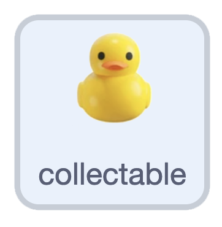
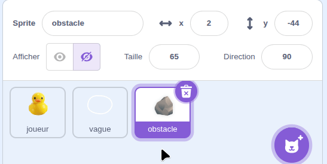
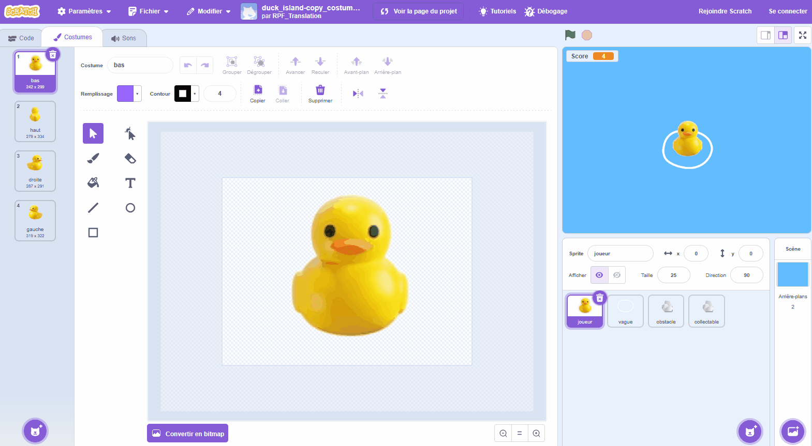
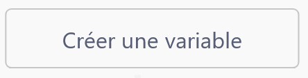
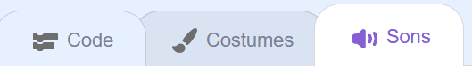
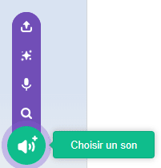

## Collectables

Dans cette étape, tu vas récupérer les canards perdus pour gagner des points. Tu peux dupliquer le sprite rocher et réutiliser ses blocs.

> [!TASK]
>
> {:width="150"}
>
> Fais un clic droit sur ton sprite **rocher** et duplique-le. Renomme la copie **collectable**.
>
> {:width="450"}

> [!TASK]
>
> Donne-lui un costume de canard. Duplique un canard à partir du sprite de ton canard ou crée-en un différent toi-même.
>
> {:width="450"}

> [!TASK]
>
> Dans `quand je commence comme un clone`{:class="block3control"}, sous le bloc `disparaitre`{:class="block3myblocks"}, ajoute un `si alors`{:class="block3control"} et fais glisser dans un `touchée ?`{:class="block3sensing"}. Choisis **joueur** dans la liste déroulante.
>
> ```blocks3
> quand je commence comme un clone
> apparaitre::custom
> répéter indéfiniment
> mouvement::custom
> disparaitre::custom
> +si <touching (player v)?> alors
> fin
> fin
> ```

> [!TASK]
>
> Crée une variable appelée `score`{:class="block3variables"} et coche sa case pour qu'elle apparaisse sur la scène.
>
> {:width="300"}

> [!TASK]
>
> Définis `score`{:class="block3variables"} à `0` au début du script `drapeau vert`{:class="block3events"}, pour que le score soit réinitialisé à chaque nouvelle partie.
>
> ```blocks3
> when green flag clicked
> set [rock speed v] to (3)
> +set [score v] to (0)
> hide
> forever
> if <key (any v) pressed?> then
> create clone of (myself v)
> end
> wait (pick random (1) to (3)) seconds
> end
> ```

> [!TASK]
>
> Ajoute un `ajouter 1 à score`{:class="block3variables"} pour augmenter le score de 1 chaque fois que tu récupères un canard.
>
> ```blocks3
> répéter indéfiniment
> mouvement::custom
> disparaitre::custom
> si <touching (player v)?> alors
> +ajouter (1) à [score v]
> fin
> fin
> ```

> [!TASK]
>
> Crée un son qui se déclenche chaque fois que tu récupères un canard. Ouvre l'onglet **Sons**.
>
> {:width="450"}

> [!TASK]
>
> Clique sur **Choisir un son** et choisis en un dans la bibliothèque.
>
> {:width="250"}

> [!TASK]
>
> Retourne dans l’onglet **Code**, ajoute un bloc `jouer le son`{:class="block3sound"} et choisis ton son.
>
> ```blocks3
> répéter indéfiniment
> mouvement::custom
> disparaitre::custom
> si <touching (player v)?> alors
> ajouter (1) à [score v]
> +jouer le son (Glug v)
> fin
> fin
> ```

> [!TASK]
>
> Enfin, `supprimer ce clone`{:class="block3control"} pour donner l’impression que le canard a été récupéré.
>
> ```blocks3
> répéter indéfiniment
> mouvement::custom
> disparaitre::custom
> si <touching (player v)?> alors
> ajouter (1) à [score v]
> jouer le son (Glug v)
> +supprimer ce clone
> fin
> fin
> ```

**Test :** fais nager ton canard jusqu'à un canard. Ton score devrait monter et le canard devrait disparaître avec un son.
