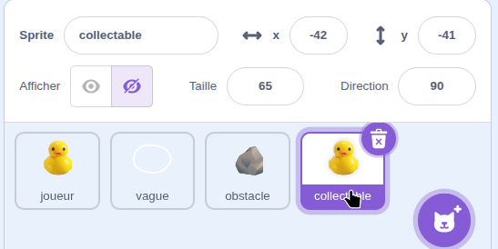
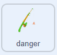
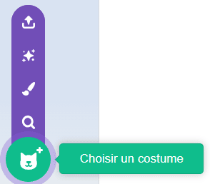
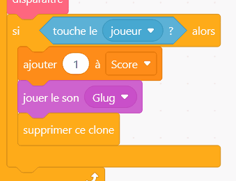
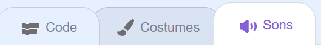
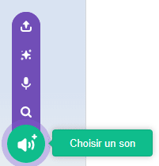

## Ajouter un danger

Dans cette étape, tu vas ajouter un danger que ton canard devra éviter, sinon la partie prendra fin. L’exemple utilise un hameçon, mais tu peux aussi choisir un autre animal, des déchets dans l’eau ou tout autre élément de ton choix.

> [!TASK]
>
> Fais un clic droit sur ton sprite **collectable** et duplique-le. Renomme la copie **danger**.
>
> {:width="450"}

> [!TASK]
>
> {:width="150"}
>
> Change son costume. Choisis-en un dans la bibliothèque ou télécharge ta propre image d'hameçon.
>
> {:width="300"}

> [!TASK]
>
> Un danger ne doit pas rapporter de points. Fais un clic droit sur le bloc `ajouter () à score`{:class="block3variables"} et supprime-le.
>
> {:width="450"}

> [!TASK]
>
> Attribue un son différent à ton danger. Ouvre l'onglet **Sons**.
>
> {:width="450"}

> [!TASK]
>
> Clique sur **Choisir un son** et choisis en un dans la bibliothèque. L’hameçon utilise un son « Rip ».
>
> {:width="250"}

> [!TASK]
>
> Retourne dans l’onglet **Code** et remplace le bloc `jouer le son`{:class="block3sound"} par ton nouveau son.
>
> ```blocks3
> quand je commence comme un clone
> apparaitre::custom
> répéter indéfiniment
> mouvement::custom
> disparaitre::custom
> si <touching (player v)?> alors
> +jouer le son (Rip v)
> supprimer ce clone
> fin
> fin
> ```

> [!TASK]
>
> Maintenant, fais en sorte que la partie se termine lorsque le danger attrape ton canard. Remplace le bloc `supprimer ce clone`{:class="block3control"} par un bloc `stop tout`{:class="block3control"}, et ajoute un `attendre`{:class="block3control"} court pour laisser le son se terminer.
>
> ```blocks3
> quand je commence comme un clone
> apparaitre::custom
> répéter indéfiniment
> mouvement::custom
> disparaitre::custom
> si <touching (player v)?> alors
> jouer le son (Rip v)
> +attendre (0.2) secondes
> +stop [tout v]
> fin
> fin
> ```

**Test :** déplace ton canard dans l’eau et vérifie que la partie se termine lorsqu’il touche un danger.

> [!TASK]
>
> Pour rendre le jeu plus difficile, fais partir chaque danger dans une direction aléatoire. Dans ton bloc `apparaitre`{:class="block3myblocks"}, ajoute un `s'orienter à`{:class="block3motion"} avec des angles `aléatoires`{:class="block3operators"}\`.
>
> ```blocks3
> define appear
> +point in direction (pick random (-180) to (180))
> go to x: (pick random (-240) to (240)) y: (pick random (-180) to (180))
> set size to (pick random (20) to (100)) %
> show
> ```

> [!TIP]
>
> L’exemple utilise une valeur comprise entre -180 et 180 pour l’angle, mais tu peux essayer différentes plages de valeurs.

> [!TASK]
>
> `s'orienter à`{:class="block3motion"} ne fait que tourner le danger. Pour le faire dériver dans cette direction, ajoute un bloc `avancer`{:class="block3motion"} de `3` pas dans la boucle du clone.
>
> ```blocks3
> quand je commence comme un clone
> apparaitre::custom
> répéter indéfiniment
> mouvement::custom
> disparaitre::custom
> si <touching (player v)?> alors
> jouer le son (Rip v)
> attendre (0.2) secondes
> stop [tout v]
> fin
> +avancer de (3) pas
> fin
> ```

**Test :** les dangers doivent dériver dans toutes les directions, et la partie doit se terminer lorsque ton canard en touche un.
