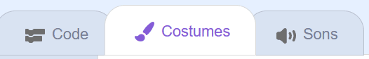
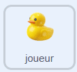
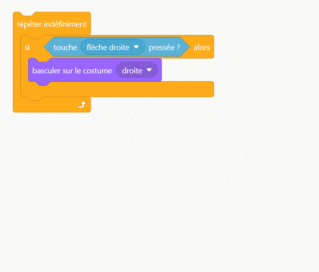

## Déplacer le canard

Dans cette étape, tu utiliseras les touches fléchées pour faire tourner le canard.

> [!TASK]
>
> Ouvre le [projet de démarrage](https://scratch.mit.edu/projects/1366224959/editor){:target="_blank"}. Connecte-toi à ton compte Scratch, puis sélectionne **remix**.
>
> {:width="200"}

> [!TIP]
>
> Le bouton **remix** n'apparaît que lorsque tu es connecté·e.

Ton canard est déjà sur la scène. Son sprite s'appelle **joueur**. D'autres sprites utiliseront ce nom plus tard pour vérifier s'ils touchent le canard.

> [!TASK]
>
> Ouvre l'onglet **Costumes** pour voir les costumes de ton canard. Ils sont nommés haut, bas, gauche et droite.
>
> {:width="450"}

> [!TIP]
>
> Si tu préfères utiliser ton propre sprite, \*\*Choisir un sprite \*\*, **Peindre**, ou **Importer un sprite**. Il faut un costume pour chaque direction : haut, bas, gauche et droite.

> [!TASK]
>
> {:width="150"}
>
> Retourne à l'onglet **code** et définis la position de départ. Ajoute un bloc `drapeau vert`{:class="block3events"}. Amène le canard à `l'avant plan`{:class="block3looks"}, `basculer sur le costume`{:class="block3looks"} sur bas, et place-le au milieu de la scène.
>
> ```blocks3
> when green flag clicked
> go to [front v] layer
> switch costume to (down v)
> go to x: (0) y: (0)
> ```

Utilise les touches fléchées pour tourner le canard.

> [!TASK]
>
> Ajoute une boucle `répéter indéfiniment`{:class="block3control"} avec un bloc `si alors`{:class="block3control"} à l'intérieur. Fais glisser dans `touche pressée`{:class="block3sensing"}, et choisis flèche droite.
>
> ```blocks3
> when green flag clicked
> go to [front v] layer
> switch costume to (down v)
> go to x: (0) y: (0)
> +forever
> if <key (right arrow v) pressed?> then
> end
> end
> ```

> [!TASK]
>
> À l'intérieur du `si`{:class="block3control"}, ajoute un `basculer sur le costume`{:class="block3looks"} pour que le canard fasse face à droite.
>
> ```blocks3
> forever
> if <key (right arrow v) pressed?> then
> +switch costume to (right v)
> end
> end
> ```

> [!TASK]
>
> Fais la même chose pour les trois autres touches : `flèche gauche`{:class="block3sensing"} → gauche, `flèche bas`{:class="block3sensing"} → bas, et `flèche haut`{:class="block3sensing"} → haut.
>
> ```blocks3
> forever
> if <key (right arrow v) pressed?> then
> switch costume to (right v)
> end
> +if <key (left arrow v) pressed?> then
> switch costume to (left v)
> end
> +if <key (down arrow v) pressed?> then
> switch costume to (down v)
> end
> +if <key (up arrow v) pressed?> then
> switch costume to (up v)
> end
> end
> ```

> [!TIP]
>
> Tu peux faire un clic droit sur un bloc pour le dupliquer.
>
> {:width="450"}

**Test :** appuie sur les touches fléchées et vérifie que ton canard tourne.
