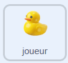
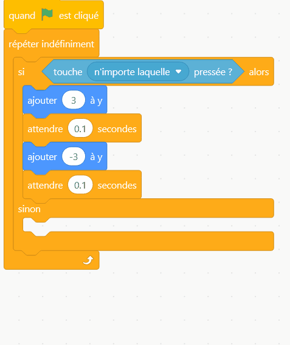

## Bob sur l'eau

Dans cette étape, tu feras flotter ton canard bob sur l'eau.

Commence par faire monter et descendre le canard quand une touche est pressée.

> [!TASK]
>
> {:width="150"}
>
> Ajoute un deuxième `drapeau vert`{:class="block3events"} avec une boucle `répéter indéfiniment`{:class="block3control"} et un bloc `si sinon`{:class="block3control"} à l'intérieur.
>
> ```blocks3
> when green flag clicked
> forever
> if <> then
> else
> end
> end
> ```

> [!TASK]
>
> Fais glisser un bloc `touche enfoncée`{:class="block3sensing"} dans le bloc `si`{:class="block3control"} et choisis **n'importe laquelle** dans la liste déroulante.
>
> ```blocks3
> when green flag clicked
> forever
> +if <key (any v) pressed?> then
> else
> end
> end
> ```

> [!TASK]
>
> Dans la partie `si`{:class="block3control"}, rends ton canard plus rapide pendant qu'une touche est pressée.
>
> ```blocks3
> when green flag clicked
> forever
> if <key (any v) pressed?> then
> +change y by (3)
> +wait (0.1) seconds
> +change y by (-3)
> +wait (0.1) seconds
> else
> end
> end
> ```

> [!TASK]
>
> Pour que le canard flotte lentement lorsqu'aucune touche n'est enfoncée, utilise les mêmes blocs, mais plus petits et plus lents. Clique droit sur les blocs que tu viens de faire pour les dupliquer, et dépose la copie dans la partie `sinon`{:class="block3control"}.
>
> {:width="450"}

> [!TASK]
>
> Modifie les valeurs pour que les mouvements du canard soient plus petits et plus lents.
>
> ```blocks3
> when green flag clicked
> forever
> if <key (any v) pressed?> then
> change y by (3)
> wait (0.1) seconds
> change y by (-3)
> wait (0.1) seconds
> else
> +change y by (1)
> +wait (0.3) seconds
> +change y by (-1)
> +wait (0.3) seconds
> end
> end
> ```

\*\*Test : clique sur le drapeau vert. Ton canard flotte doucement tout seul, et plus rapidement lorsque tu appuies sur une touche fléchée.