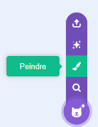
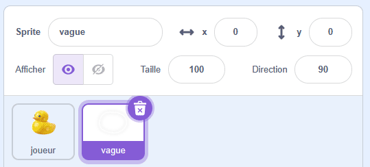
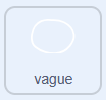
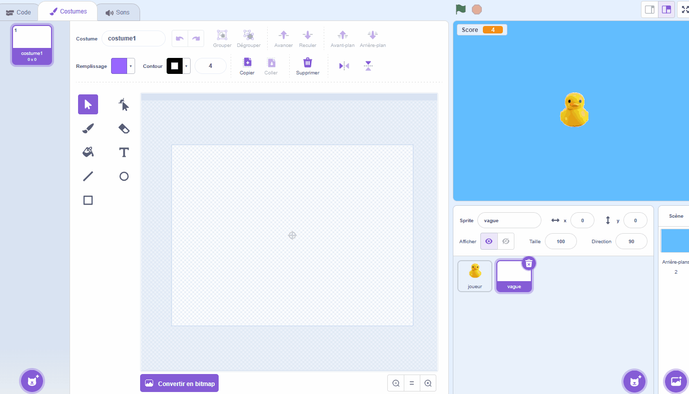
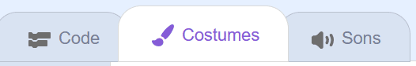
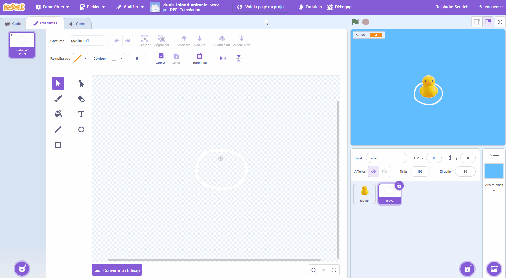

## Créer des vagues

Pour donner l'impression que le canard se déplace réellement dans l'eau, tu peux ajouter une vague qui évolue au fur et à mesure que le canard bouge.

> [!TASK]
>
> Créz un nouveau sprite avec l'icône de sprite **Peindre**.
>
> {:width="250"}

> [!TASK]
>
> Nomme ton sprite **vague**.
>
> {:width="450"}

> [!TASK]
>
> {:width="150"}
>
> Utilise les outils de peinture pour dessiner un cercle. C'est la forme de ta vague.
>
> Redimensionne-la pour qu'elle soit un peu plus grande que ton canard. Utilise une couleur blanche ou claire pour le contour et retire le remplissage.
>
> {:width="350"}

> [!TASK]
>
> Va dans l'onglet **Code**. Définis la vague avec un `drapeau vert`{:class="block3events"}, placez-la à l'arrière-plan et positionne-la juste en dessous du canard.
>
> ```blocks3
> when green flag clicked
> go to [back v] layer
> go to x: (0) y: (-20)
> ```

> [!TASK]
>
> Fais bouger la vague lentement lorsqu'aucune touche n'est enfoncée.
>
> Ajoute un bloc `si alors`{:class="block3control"} à l'intérieur d'une boucle `répéter indéfiniment`{:class="block3control"}. Dans la partie `sinon`{:class="block3control"}, ajoute des blocs pour faire monter et descendre la vague, dans le sens opposé à celui du canard.
>
> ```blocks3
> when green flag clicked
> go to [back v] layer
> go to x: (0) y: (-20)
> forever
> +if <> then
> else
> change y by (-1)
> wait (0.3) seconds
> change y by (1)
> wait (0.3) seconds
> end
> end
> ```

**Test :** la vague se déplace dans le sens inverse de ton canard, ce qui donne l'impression que le canard flotte.

Maintenant, crée une version animée pour les moments où le canard bouge.

> [!TASK]
>
> Sélectionne l'onglet **Costumes**.
>
> {:width="450"}

> [!TASK]
>
> **Duplique** le cercle et agrandis légèrement le nouveau. Puis duplique-le à nouveau et agrandis-le encore davantage. Tu devrais avoir trois costumes au total.
>
> {:width="450"}

> [!TASK]
>
> Fais glisser un bloc `touche enfoncée`{:class="block3sensing"} dans le bloc `si`{:class="block3control"} et choisis **n'importe laquelle**.
>
> ```blocks3
> when green flag clicked
> go to [back v] layer
> go to x: (0) y: (-20)
> forever
> if <key (any v) pressed?> then
> else
> change y by (-1)
> wait (0.3) seconds
> change y by (1)
> wait (0.3) seconds
> end
> end
> ```

> [!TASK]
>
> Dans la partie `si`{:class="block3control"}, ajoute un `costume suivant`{:class="block3looks"} et un `attendre`{:class="block3control"} pour animer la vague pendant que le canard se déplace.
>
> ```blocks3
> when green flag clicked
> go to [back v] layer
> go to x: (0) y: (-20)
> forever
> if <key (any v) pressed?> then
> +next costume
> +wait (0.1) seconds
> else
> change y by (-1)
> wait (0.3) seconds
> change y by (1)
> wait (0.3) seconds
> end
> end
> ```

> [!TASK]
>
> Enfin, ajoute un `basculer sur le costume1`{:class="block3looks"} en haut de `sinon`{:class="block3control"}, afin que la vague commence toujours à partir du plus petit cercle.
>
> ```blocks3
> when green flag clicked
> go to [back v] layer
> go to x: (0) y: (-20)
> forever
> if <key (any v) pressed?> then
> next costume
> wait (0.1) seconds
> else
> +switch costume to (costume1 v)
> change y by (-1)
> wait (0.3) seconds
> change y by (1)
> wait (0.3) seconds
> end
> end
> ```

**Test :** la vague se déplace lentement quand aucune touche n'est enfoncée, et change lorsque tu appuies sur une touche fléchée.
