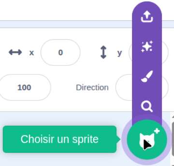
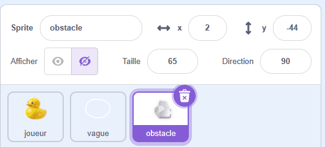
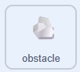
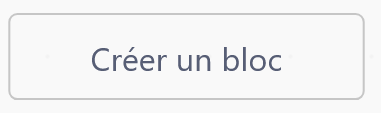

## Ajouter des rochers

Dans cette étape, tu ajouteras des rochers comme obstacles que ton canard devra contourner. Les rochers bougent en arrière-plan, ce qui donne l'impression que le canard nage.

> [!TASK]
>
> Ajoute un nouveau sprite pour tes rochers. Dessines-en un avec les outils de peinture, ou choisis-en un dans la bibliothèque.
>
> {:width="250"}

> [!TASK]
>
> Nomme ton sprite **obstacle**
>
> {:width="350"}

> [!TIP]
>
> Les rochers de l'exemple sont les emoji rocher 🪨, copiés et collés dans une zone de texte de l'onglet **Peindre**.

> [!TASK]
>
> {:width="150"}
>
> Les rochers sont faits à partir de **clones**, qui sont des copies du sprite. Démarre le script avec un `drapeau vert`{:class="block3events"}, cache le sprite original, et crée un clone.
>
> ```blocks3
> when green flag clicked
> hide
> create clone of (myself v)
> ```

> [!TASK]
>
> Chaque rocher doit apparaître à un endroit aléatoire. Sélectionne **Créer un bloc** et nomme-le `apparaitre`{:class="block3myblocks"}.
>
> {:width="250"}

> [!TASK]
>
> Dans le menu `Mes blocs`{:class="block3myblocks"}, fais glisser un `définir apparaitre`{:class="block3myblocks"}.
>
> ```blocks3
> define appear
> ```

> [!TASK]
>
> Sous `définir apparaitre`{:class="block3myblocks"}, ajoute un `aller à`{:class="block3motion"} et un `montrer`{:class="block3looks"}. L'exemple utilise `nombre aléatoire`{:class="block3operators"} pour x et y, de sorte que chaque rocher apparaît dans un endroit différent.
>
> ```blocks3
> define appear
> go to x: (pick random (-240) to (240)) y: (pick random (-180) to (180))
> show
> ```

> [!TASK]
>
> Tu peux également donner à chaque rocher une taille aléatoire.
>
> ```blocks3
> define appear
> go to x: (pick random (-240) to (240)) y: (pick random (-180) to (180))
> +set size to (pick random (20) to (100)) %
> show
> ```

> [!TASK]
>
> Dans `quand je commence comme un clone`{:class="block3control"}, fais glisser dans ton bloc `apparaitre`{:class="block3myblocks"}.
>
> ```blocks3
> quand je commence comme un clone
> apparaitre::custom
> ```

\*\*Test : clique sur le drapeau vert plusieurs fois. Un rocher apparaît à une taille et à un endroit différents à chaque fois.

Les rochers doivent apparaître lorsque tu appuies sur les touches fléchées. Pour cela, déclenche le clone avec une touche pressée au lieu du drapeau vert.

> [!TASK]
>
> Déplace le bloc `créer un clone`{:class="block3control"} dans un bloc `si alors`{:class="block3control"}, et dépose `touche pressée`{:class="block3sensing"} sur **n'importe laquelle**.
>
> ```blocks3
> when green flag clicked
> hide
> +if <key (any v) pressed?> then
> create clone of (myself v)
> end
> ```

> [!TASK]
>
> Déplace cela dans une boucle `répéter indéfiniment`{:class="block3control"} pour continuer.
>
> ```blocks3
> when green flag clicked
> hide
> +forever
> if <key (any v) pressed?> then
> create clone of (myself v)
> end
> end
> ```

**Test :** appuie sur les touches fléchées et regarde plein de rochers apparaître à des endroits et dans des tailles aléatoires.

Pour limiter le nombre de rochers clonés, ajoute un petit délai à la fin. C'est la fréquence à laquelle les rochers apparaîtront.

> [!TASK]
>
> Ajoute un `attendre`{:class="block3control"} avec un `nombre aléatoire`{:class="block3operators"}.
>
> ```blocks3
> when green flag clicked
> hide
> forever
> if <key (any v) pressed?> then
> create clone of (myself v)
> end
> +wait (pick random (1) to (3)) seconds
> end
> ```

**Test :** appuie sur les touches fléchées. Les rochers devraient apparaître à des endroits et de tailles aléatoires, avec un intervalle de 1 à 3 secondes entre chaque apparition.

> [!TIP]
>
> Expérimente avec le temps d'attente pour faire apparaître plus ou moins de rochers.
