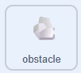

## Rochers au bord

Dans cette étape, tu feras en sorte que chaque rocher commence au bord vers lequel le canard fait face.

> [!TASK]
>
> {:width="150"}
>
> Ajoute un `si alors`{:class="block3control"} avec `touche pressée`{:class="block3sensing"} réglé sur **flèche droite** au bas du bloc `définir apparaitre`{:class="block3myblocks"},
>
> ```blocks3
> define appear
> go to x: (pick random (-240) to (240)) y: (pick random (-180) to (180))
> set size to (pick random (20) to (100)) %
> show
> +if <key (right arrow v) pressed?> then
> end
> ```

> [!TASK]
>
> Définis **x** sur `240` pour que le rocher apparaisse au bord droit.
>
> ```blocks3
> define appear
> go to x: (pick random (-240) to (240)) y: (pick random (-180) to (180))
> set size to (pick random (20) to (100)) %
> show
> if <key (right arrow v) pressed?> then
> +set x to (240)
> end
> ```

**Test :** appuie sur la flèche droite. Vérifie que les rochers apparaissent depuis le bord droit, avec le délai de 1 à 3 secondes que tu as défini précédemment.

> [!TASK]
>
> Fais la même chose pour les trois autres directions.
>
> ```blocks3
> define appear
> go to x: (pick random (-240) to (240)) y: (pick random (-180) to (180))
> set size to (pick random (20) to (100)) %
> show
> if <key (right arrow v) pressed?> then
> set x to (240)
> end
> +if <key (left arrow v) pressed?> then
> set x to (-240)
> end
> +if <key (down arrow v) pressed?> then
> set y to (-180)
> end
> +if <key (up arrow v) pressed?> then
> set y to (180)
> end
> ```

**Test :** appuie sur les différentes touches fléchées. De nouveaux rochers apparaissent du côté où le canard est tourné.