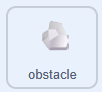
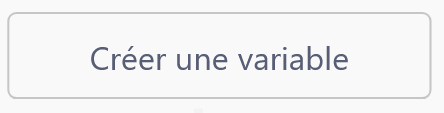
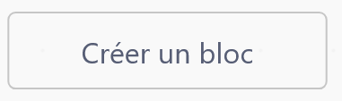

## Déplacer les rochers

Les rochers se déplacent sur la scène, ce qui donne l'impression que ton canard nage.

> [!TASK]
>
> {:width="150"}
>
> Crée une variable appelée `vitesse rocher`{:class="block3variables"}.
>
> {:width="250"}

> [!TASK]
>
> Définis la vitesse à `3` au début du script `drapeau vert`{:class="block3events"}.
>
> ```blocks3
> when green flag clicked
> +set [rock speed v] to (3)
> hide
> forever
> if <key (any v) pressed?> then
> create clone of (myself v)
> end
> wait (pick random (1) to (3)) seconds
> end
> ```

> [!TASK]
>
> Sélectionne **Créer un bloc** et nomme-le `mouvement`{:class="block3myblocks"}.
>
> {:width="250"}

> [!TASK]
>
> Sous `définir mouvement`{:class="block3myblocks"}, ajoute un `si alors`{:class="block3control"} pour la **flèche gauche**, et un `ajouter () à x`{:class="block3motion"} avec `vitesse rocher`{:class="block3variables"} dedans.
>
> ```blocks3
> define move
> if <key (left arrow v) pressed?> then
> change x by (rock speed)
> end
> ```

> [!TASK]
>
> Ajoute un autre `si alors`{:class="block3control"} pour la **flèche bas**, avec un `ajouter () à y`{:class="block3motion"} et `vitesse rocher`{:class="block3variables"}.
>
> ```blocks3
> define move
> if <key (left arrow v) pressed?> then
> change x by (rock speed)
> end
> +if <key (down arrow v) pressed?> then
> change y by (rock speed)
> end
> ```

> [!TASK]
>
> Ajoute une boucle `répéter indéfiniment`{:class="block3control"} en bas de `quand je commence comme un clone`{:class="block3control"}. Va à nouveau dans le menu `Mes Blocs`{:class="block3myblocks"} et fais glisser ton bloc `mouvement`{:class="block3myblocks"} à l'intérieur.
>
> ```blocks3
> quand je commence comme un clone
> apparaitre::custom
> +répéter indéfiniment
> mouvement::custom
> fin
> ```

**Test :** maintiens la flèche **gauche** ou **bas**. Les rochers dérivent en ayant l'impression que ton canard nage !

> [!TASK]
>
> La **flèche de droite** doit déplacer le rocher dans la direction opposée. Ajoute un `si alors`{:class="block3control"} pour le rocher, et un `ajouter () à x`{:class="block3motion"}. Cette fois, utilise un opérateur `() - ()`{:class="block3operators"} pour soustraire `vitesse rocher`{:class="block3variables"} à `0`.
>
> ```blocks3
> define move
> if <key (left arrow v) pressed?> then
> change x by (rock speed)
> end
> if <key (down arrow v) pressed?> then
> change y by (rock speed)
> end
> +if <key (right arrow v) pressed?> then
> change x by ((0) - (rock speed))
> end
> ```

> [!TASK]
>
> Fais la même chose pour la **flèche haut**: un `ajouter () à y`{:class="block3motion"} qui soustrait `vitesse rocher`{:class="block3variables"} à `0`.
>
> ```blocks3
> define move
> if <key (left arrow v) pressed?> then
> change x by (rock speed)
> end
> if <key (down arrow v) pressed?> then
> change y by (rock speed)
> end
> if <key (right arrow v) pressed?> then
> change x by ((0) - (rock speed))
> end
> +if <key (up arrow v) pressed?> then
> change y by ((0) - (rock speed))
> end
> ```

**Test :** maintiens la touche fléchée. Les rochers doivent glisser dans la bonne direction, quelle que soit la direction choisie, pour donner l’impression que ton canard est en train de nager.
