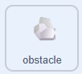
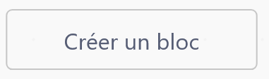

## Retirer les rochers

Dans cette étape, tu supprimeras chaque rocher une fois qu'il aura quitté la scène, afin que ton jeu continue de fonctionner sans problème. Tu vas créer ceci comme un bloc `disparaitre`{:class="block3myblocks"}.

> [!TASK]
>
> {:width="150"}
>
> Sélectionne **Créer un bloc** et nomme-le `disparaitre`{:class="block3myblocks"}.
>
> {:width="250"}

> [!TASK]
>
> Sous `définir disparaitre`{:class="block3myblocks"}, ajoute un bloc `si alors`{:class="block3control"} et fais glisser un bloc `et`{:class="block3operators"} dedans.
>
> ```blocks3
> define disappear
> if <<> and <>> then
> end
> ```

> [!TASK]
>
> Dans le côté gauche de `et`{:class="block3operators"}, mets `touche pressée`{:class="block3sensing"} sur **flèche droite**.
>
> ```blocks3
> define disappear
> if <<key (right arrow v) pressed?> and <>> then
> end
> ```

> [!TASK]
>
> Dans le côté droit du bloc `et`{:class="block3operators"}, fais glisser un `moins que`{:class="block3operators"}.
>
> ```blocks3
> define disappear
> if <<key (right arrow v) pressed?> and <() < ()>> then
> end
> ```

> [!TASK]
>
> Mets `position x`{:class="block3motion"} à gauche et `-240` à droite.
>
> ```blocks3
> define disappear
> if <<key (right arrow v) pressed?> and <(x position) < (-240)>> then
> end
> ```

> [!TASK]
>
> Ajoute un `supprimer ce clone`{:class="block3control"} à l'intérieur du `si`{:class="block3control"}.
>
> ```blocks3
> define disappear
> if <<key (right arrow v) pressed?> and <(x position) < (-240)>> then
> +delete this clone
> end
> ```

> [!TASK]
>
> Sous `mouvement`{:class="block3myblocks"} dans la boucle coner, fais glisser ton bloc `disparaitre`{:class="block3myblocks"}.
>
> ```blocks3
> quand je commence comme un clone
> apparaitre::custom
> répéter indéfiniment
> mouvement::custom
> +disparaitre::custom
> fin
> ```

**Test :** fais nager ton canard vers la droite. Quand les rochers atteignent la gauche de la scène, ils disparaissent.

> [!TASK]
>
> Duplique le bloc `si`{:class="block3control"} pour les 3 autres bords, en changeant la valeur, le x/y et les nombres.
>
> ```blocks3
> define disappear
> if <<key (right arrow v) pressed?> and <(x position) < (-240)>> then
> delete this clone
> end
> +if <<key (left arrow v) pressed?> and <(x position) > (240)>> then
> delete this clone
> end
> +if <<key (down arrow v) pressed?> and <(y position) > (180)>> then
> delete this clone
> end
> +if <<key (up arrow v) pressed?> and <(y position) < (-180)>> then
> delete this clone
> end
> ```

**Test :** fais nager ton canard pendant un moment. Les rochers doivent disparaître dès qu’ils sortent de l’écran, quel que soit le bord par lequel ils passent, afin que ton jeu continue de fonctionner sans ralentir.

> [!DEBUG]
>
> Selon la taille et la position du costume de ton obstacle, tu devras peut-être ajuster les valeurs correspondant aux bords de l’écran. Si tes rochers disparaissent trop tôt ou restent collés au bord de l’écran, essaie des valeurs légèrement plus petites ou plus grandes (par exemple `-220` ou `-260` au lieu de `-240`).
