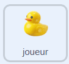
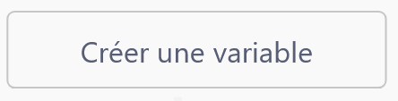
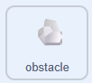

## Bloquer le canard

Pour le moment, ton canard traverse les rochers sans être gêné. Dans cette étape, tu feras en sorte que les rochers bloquent son passage.

> [!TASK]
>
> {:width="150"}
>
> Dans le sprite du **joueur**, crée 4 variables : `bloque droite`{:class="block3variables"}, `bloque gauche`{:class="block3variables"}, `bloque haut`{:class="block3variables"}, et `bloque bas`{:class="block3variables"}. Décoche leurs cases pour qu'ils n'apparaissent pas sur la scène.
>
> {:width="250"}

Tu as créé ce script `basculer sur le costume`{:class="block3looks"} pour la flèche droite à l'étape 2 :

```blocks3
if <key (right arrow v) pressed?> then
switch costume to (right v)
end
```

> [!TASK]
>
> Sous le bloc `basculer sur le costume`{:class="block3looks"}, ajoute un bloc `si alors`{:class="block3control"}. Fais glisser dans un `touchée ?`{:class="block3sensing"} et choisis **obstacle**.
>
> ```blocks3
> if <key (right arrow v) pressed?> then
> switch costume to (right v)
> +if <touching (obstacle v)?> then
> else
> end
> end
> ```

> [!TASK]
>
> Quand il touche un rocher, ajoute un bloc `définir bloque droite`{:class="block3variables"} et définis-le à `oui`.
>
> ```blocks3
> if <key (right arrow v) pressed?> then
> switch costume to (right v)
> if <touching (obstacle v)?> then
> +set [right blocked v] to [yes]
> else
> end
> end
> ```

> [!TASK]
>
> Ajoute un `attendre 0.5 secondes`{:class="block3control"} juste après.
>
> ```blocks3
> if <key (right arrow v) pressed?> then
> switch costume to (right v)
> if <touching (obstacle v)?> then
> set [right blocked v] to [yes]
> +wait (0.5) seconds
> else
> end
> end
> ```

> [!TASK]
>
> Fais la même chose dans le bloc `sinon`{:class="block3control"}: ajoute un `définir bloque droite`{:class="block3variables"} et mets-le à `non`.
>
> ```blocks3
> if <key (right arrow v) pressed?> then
> switch costume to (right v)
> if <touching (obstacle v)?> then
> set [right blocked v] to [yes]
> wait (0.5) seconds
> else
> +set [right blocked v] to [no]
> end
> end
> ```

> [!TIP]
>
> Le `attendre 0.5 secondes`{:class="block3control"} te donne un moment pour changer de direction après avoir heurté un rocher.

> [!TASK]
>
> Fais la même chose pour les trois autres touches fléchées, en utilisant `bloque gauche`{:class="block3variables"}, `bloque haut`{:class="block3variables"}, et `bloque bas`{:class="block3variables"}.

Maintenant, ajoute les variables de bloc au rocher, de sorte qu'il cesse de se déplacer quand il est bloqué.

> [!TASK]
>
> {:width="150"}
>
> Rends-toi à ton sprite **rocher**. Dans le bloc `mouvement`{:class="block3myblocks"}, ajoute un bloc `et`{:class="block3operators"} et fais glisser le bloc `touche pressée`{:class="block3sensing"} dans la case de gauche.
>
> ```blocks3
> define move
> +if <<key (right arrow v) pressed?> and <>> then
> change x by ((0) - (rock speed))
> end
> ```

> [!TASK]
>
> Fais glisser un bloc `égal`{:class="block3operators"} dans le `et`{:class="block3operators"}.
>
> ```blocks3
> define move
> if <<key (right arrow v) pressed?> and <() = ()>> then
> change x by ((0) - (rock speed))
> end
> ```

> [!TASK]
>
> Place `bloque droite`{:class="block3variables"} à gauche et `non` à droite pour que le rocher ne bouge que lorsque la flèche droite est pressée et que la droite n'est pas bloquée.
>
> ```blocks3
> define move
> if <<key (right arrow v) pressed?> and <(right blocked) = [no]>> then
> change x by ((0) - (rock speed))
> end
> ```

> [!TASK]
>
> Duplique et fais la même chose pour chacune de tes touches fléchées.
>
> ```blocks3
> define move
> if <<key (right arrow v) pressed?> and <(right blocked) = [no]>> then
> change x by ((0) - (rock speed))
> end
> +if <<key (left arrow v) pressed?> and <(left blocked) = [no]>> then
> change x by (rock speed)
> end
> +if <<key (down arrow v) pressed?> and <(down blocked) = [no]>> then
> change y by (rock speed)
> end
> +if <<key (up arrow v) pressed?> and <(up blocked) = [no]>> then
> change y by ((0) - (rock speed))
> end
> ```

**Test :** fais nager ton canard jusqu'à un rocher. Ton canard doit s’arrêter au lieu de nager par-dessus le rocher.

> [!DEBUG]
>
> Le `attendre 0.5 secondes`{:class="block3control"} te laisse un court instant pour changer de direction après un choc. Mais si ton canard reste coincé contre un rocher et ne parvient pas à s’en éloigner, c’est parce que les deux costumes se chevauchent.
>
> Essaie de déplacer le point central du costume de ton canard dans l’éditeur de peinture, ou de réduire légèrement la taille du sprite. Fais plusieurs essais jusqu’à ce que ton canard puisse toujours se dégager après une collision.
