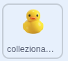
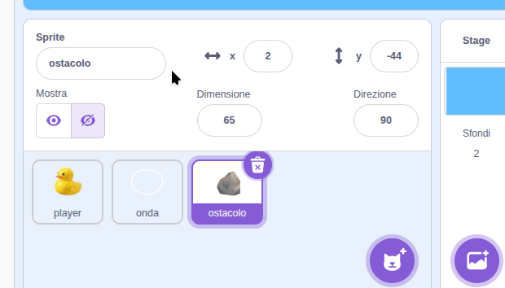
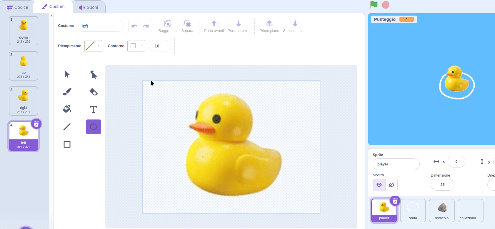
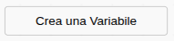
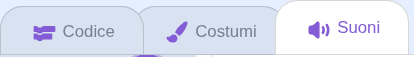
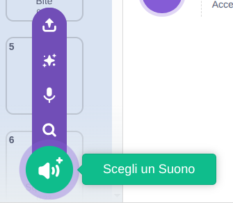

## Raccolta di oggetti

In questa fase, raccoglierai le anatre perse per ottenere punti. È possibile duplicare lo sprite della roccia e riutilizzarne i blocchi.

> [!TASK]
>
> {:width="150"}
>
> Fai clic con il pulsante destro del mouse sullo sprite della **roccia** e duplicalo. Rinominare la copia **collezionabile**.
>
> {:width="450"}

> [!TASK]
>
> Travestilo da anatra. Copiane uno dal tuo sprite dell'anatra, oppure creane uno diverso da zero.
>
> {:width="450"}

> [!TASK]
>
> In `quando vengo clonato`{:class="block3control"}, sotto il blocco `sparire`{:class="block3myblocks"}, aggiungi un `se allora`{:class="block3control"} e trascina un `sta toccando?`{:class="block3sensing"}. Seleziona **giocatore** dal menu a tendina.
>
> ```blocks3
> when I start as a clone
> apparire::custom
> forever
> muovere::custom
> sparire::custom
> +if <touching (player v)?> then
> end
> end
> ```

> [!TASK]
>
> Crea una variabile chiamata `punteggio`{:class="block3variables"} e seleziona la relativa casella di controllo in modo che venga visualizzata sul palco.
>
> {:width="300"}

> [!TASK]
>
> Imposta `punteggio`{:class="block3variables"} su `0` all'inizio dello script `bandierina verde`{:class="block3events"}, in modo che venga reimpostato a ogni partita.
>
> ```blocks3
> when green flag clicked
> set [rock speed v] to (3)
> +set [score v] to (0)
> hide
> forever
> if <key (any v) pressed?> then
> create clone of (myself v)
> end
> wait (pick random (1) to (3)) seconds
> end
> ```

> [!TASK]
>
> Aggiungi un `cambia punteggio di 1`{:class="block3variables"} in modo che il punteggio aumenti quando viene raccolta un'anatra.
>
> ```blocks3
> forever
> muovere::custom
> sparire::custom
> if <touching (player v)?> then
> +change [score v] by (1)
> end
> end
> ```

> [!TASK]
>
> Emetti un suono dopo aver raccolto un'anatra. Apri la scheda **Suoni**.
>
> {:width="450"}

> [!TASK]
>
> Fai clic su **Scegli un suono** e selezionane uno dalla libreria.
>
> {:width="250"}

> [!TASK]
>
> Torna alla scheda **Codice**, aggiungi un blocco `avvia riproduzione suono`{:class="block3sound"} e scegli il tuo suono.
>
> ```blocks3
> forever
> muovere::custom
> sparire::custom
> if <touching (player v)?> then
> change [score v] by (1)
> +start sound (Glug v)
> end
> end
> ```

> [!TASK]
>
> Infine, elimina questo clone in modo che l'anatra sembri essere stata raccolta.
>
> ```blocks3
> forever
> muovere::custom
> sparire::custom
> if <touching (player v)?> then
> change [score v] by (1)
> start sound (Glug v)
> +delete this clone
> end
> end
> ```

**Prova:** Nuota contro un'anatra. Il tuo punteggio dovrebbe aumentare e l'anatra dovrebbe scomparire emettendo un suono.
