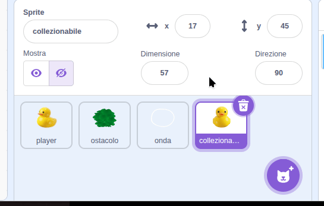
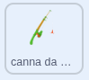
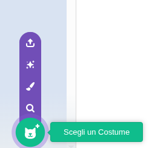
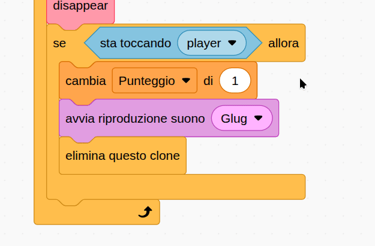
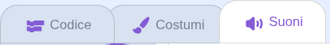
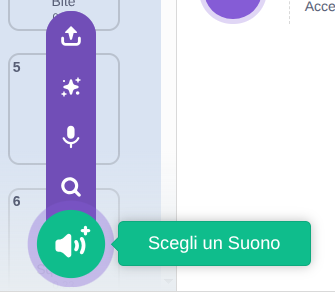

## Aggiungi un pericolo

In questa fase, aggiungerai un ostacolo che la tua anatra dovrà schivare, altrimenti la partita finirà. L'esempio utilizza un amo, ma potrebbe trattarsi di altri animali selvatici, rifiuti nell'acqua o qualsiasi altra cosa tu scelga.

> [!TASK]
>
> Fai clic con il pulsante destro del mouse sul tuo sprite **da collezione** e duplicalo. Rinomina la copia **pericolo**.
>
> {:width="450"}

> [!TASK]
>
> {:width="150"}
>
> Cambia il suo costume. Scegli un'immagine dalla galleria oppure carica la tua immagine di una canna da pesca.
>
> {:width="300"}

> [!TASK]
>
> Un pericolo non dovrebbe far guadagnare punti. Fai clic con il pulsante destro del mouse sul blocco `cambia punteggio`{:class="block3variables"} ed eliminalo.
>
> {:width="450"}

> [!TASK]
>
> Dai un suono diverso al tuo segnale di pericolo. Apri la scheda **Suoni**.
>
> {:width="450"}

> [!TASK]
>
> Fai clic su **Scegli un suono** e selezionane uno dalla libreria. La canna da pesca utilizza un suono "Rip".
>
> {:width="250"}

> [!TASK]
>
> Tornando alla scheda **Codice**, modifica `avvia riproduzione`{:class="block3sound"} con il tuo nuovo suono.
>
> ```blocks3
> when I start as a clone
> apparire::custom
> forever
> muovere::custom
> sparire::custom
> if <touching (player v)?> then
> +start sound (Rip v)
> delete this clone
> end
> end
> ```

> [!TASK]
>
> Ora fai terminare il gioco quando l'ostacolo cattura la tua anatra. Sostituisci `elimina questo clone`{:class="block3control"} con un `ferma tutto`{:class="block3control"} e aggiungi un breve `attendi`{:class="block3control"} in modo che il suono possa terminare.
>
> ```blocks3
> when I start as a clone
> apparire::custom
> forever
> muovere::custom
> sparire::custom
> if <touching (player v)?> then
> start sound (Rip v)
> +wait (0.2) seconds
> +stop [all v]
> end
> end
> ```

**Test:** Nuota in giro e controlla se il gioco termina quando la tua anatra colpisce un ostacolo.

> [!TASK]
>
> Per rendere il gioco più difficile, invia ogni pericolo in una direzione casuale. Nel tuo blocco `apparire`{:class="block3myblocks"} aggiungi un `punta in direzione{:class="block3motion"} con angoli `casuali\`{:class="block3operators"}.
>
> ```blocks3
> define appear
> +point in direction (pick random (-180) to (180))
> go to x: (pick random (-240) to (240)) y: (pick random (-180) to (180))
> set size to (pick random (20) to (100)) %
> show
> ```

> [!TIP]
>
> L'esempio utilizza un intervallo da `-180` a `180` per l'angolo, ma è possibile sperimentare con valori diversi.

> [!TASK]
>
> `punta in direzione`{:class="block3motion"} gira solo il pericolo. Per farlo muovere in quella direzione, aggiungi un blocco `muovere`{:class="block3motion"} impostato su `3` passi nel ciclo clone.
>
> ```blocks3
> when I start as a clone
> apparire::custom
> forever
> muovere::custom
> sparire::custom
> if <touching (player v)?> then
> start sound (Rip v)
> wait (0.2) seconds
> stop [all v]
> end
> +move (3) steps
> end
> ```

**Test:** Gli ostacoli dovrebbero spostarsi e il gioco dovrebbe terminare quando la tua anatra ne colpisce uno.
