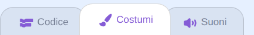
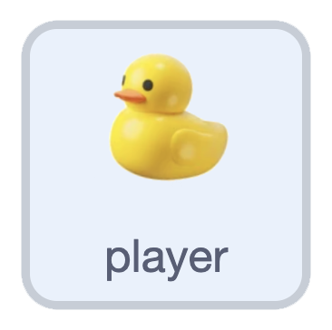
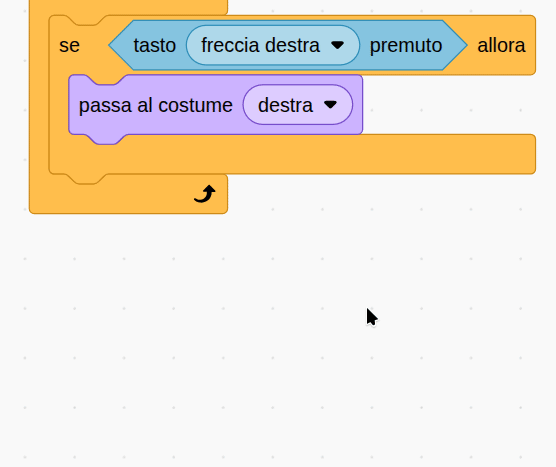

## Sposta l'anatra

In questo passaggio, si utilizzano i tasti freccia per girare l'anatra.

> [!TASK]
>
> Apri un [nuovo progetto Scratch](https://scratch.mit.edu/projects/1366224959/editor){:target="_blank"}. Accedi al tuo account Scratch, quindi seleziona **remix**.
>
> {:width="200"}

> [!TIP]
>
> Il pulsante **remix** appare solo quando hai effettuato l'accesso.

La tua anatra è già sullo stage. Il suo sprite si chiama **player**. Altri sprite useranno questo nome in seguito per verificare se stanno toccando l'anatra.

> [!TASK]
>
> Apri la scheda **Costumi** per vedere i costumi della tua anatra. Questi sono etichettati come su, giù, sinistra e destra.
>
> {:width="450"}

> [!TIP]
>
> Se preferisci usare il tuo sprite, **scegli**, **disegna** o **carica** uno. Serve un costume per ogni direzione: su, giù, sinistra e destra.

> [!TASK]
>
> {:width="150"}
>
> Torna alla **scheda codice** e imposta la posizione di partenza. Aggiungi un blocco `bandiera verde`{:class="block3events"}. Porta l'anatra nello strato `fronte`{:class="block3looks"}, `passa al costume`{:class="block3looks"} dal basso e posizionala al centro dello stage.
>
> ```blocks3
> when green flag clicked
> go to [front v] layer
> switch costume to (down v)
> go to x: (0) y: (0)
> ```

Usa i tasti freccia per girare l'anatra.

> [!TASK]
>
> Aggiungi un ciclo `per sempre`{:class="block3control"} con un blocco `se allora`{:class="block3control"} al suo interno. Trascina un `tasto premuto`{:class="block3sensing"} e scegli la freccia destra.
>
> ```blocks3
> when green flag clicked
> go to [front v] layer
> switch costume to (down v)
> go to x: (0) y: (0)
> +forever
> if <key (right arrow v) pressed?> then
> end
> end
> ```

> [!TASK]
>
> All'interno dell'istruzione `se`{:class="block3control"}, aggiungi un `passa al costume`{:class="block3looks"} in modo che l'anatra sia rivolta a destra.
>
> ```blocks3
> forever
> if <key (right arrow v) pressed?> then
> +switch costume to (right v)
> end
> end
> ```

> [!TASK]
>
> Fai lo stesso per gli altri tre tasti: `freccia sinistra`{:class="block3sensing"} → sinistra, `freccia giù`{:class="block3sensing"} → giù e `freccia su`{:class="block3sensing"} → su.
>
> ```blocks3
> forever
> if <key (right arrow v) pressed?> then
> switch costume to (right v)
> end
> +if <key (left arrow v) pressed?> then
> switch costume to (left v)
> end
> +if <key (down arrow v) pressed?> then
> switch costume to (down v)
> end
> +if <key (up arrow v) pressed?> then
> switch costume to (up v)
> end
> end
> ```

> [!TIP]
>
> Puoi fare clic con il pulsante destro del mouse su un blocco per duplicarlo.
>
> {:width="450"}

**Test:** Premi i tasti freccia e verifica che la tua anatra giri.
