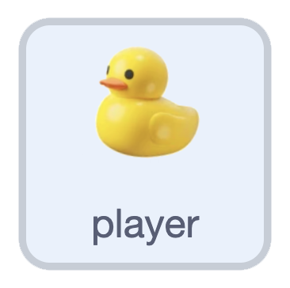
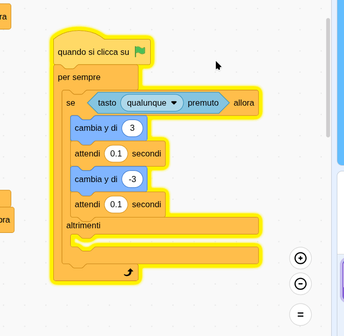

## Bob sull'acqua

In questo passaggio, farai galleggiare la tua anatra sull'acqua.

Inizia facendo in modo che l'anatra si muova su e giù quando viene premuto un tasto.

> [!TASK]
>
> {:width="150"}
>
> Aggiungi un secondo blocco `bandierina verde`{:class="block3events"} con un ciclo `per sempre`{:class="block3control"} e un blocco `se allora`{:class="block3control"} al suo interno.
>
> ```blocks3
> when green flag clicked
> forever
> if <> then
> else
> end
> end
> ```

> [!TASK]
>
> Trascina un `tasto premuto`{:class="block3sensing"} nel blocco `se`{:class="block3control"} e scegli **qualsiasi** dall'elenco a discesa.
>
> ```blocks3
> when green flag clicked
> forever
> +if <key (any v) pressed?> then
> else
> end
> end
> ```

> [!TASK]
>
> Nella parte `se`{:class="block3control"}, fai velocemente la tua anatra mentre un tasto viene premuto.
>
> ```blocks3
> when green flag clicked
> forever
> if <key (any v) pressed?> then
> +change y by (3)
> +wait (0.1) seconds
> +change y by (-3)
> +wait (0.1) seconds
> else
> end
> end
> ```

> [!TASK]
>
> Per far sì che l'anatra si muova lentamente quando non viene premuto alcun tasto, usa gli stessi blocchi, ma più piccoli e più lenti. Fai clic con il pulsante destro del mouse sui blocchi appena creati per duplicarli e rilascia la copia nella parte `altrimenti`{:class="block3control"}.
>
> {:width="450"}

> [!TASK]
>
> Modifica i valori in modo che il movimento dell'anatra sia più piccolo e più lento.
>
> ```blocks3
> when green flag clicked
> forever
> if <key (any v) pressed?> then
> change y by (3)
> wait (0.1) seconds
> change y by (-3)
> wait (0.1) seconds
> else
> +change y by (1)
> +wait (0.3) seconds
> +change y by (-1)
> +wait (0.3) seconds
> end
> end
> ```

**Prova:** Clicca sulla bandierina verde. La tua papera si muove dolcemente da sola, e più velocemente quando premi un tasto freccia.