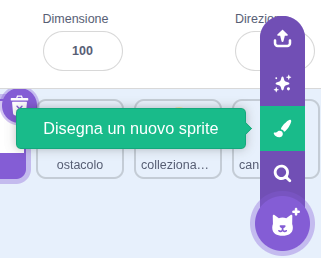
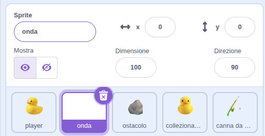
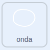
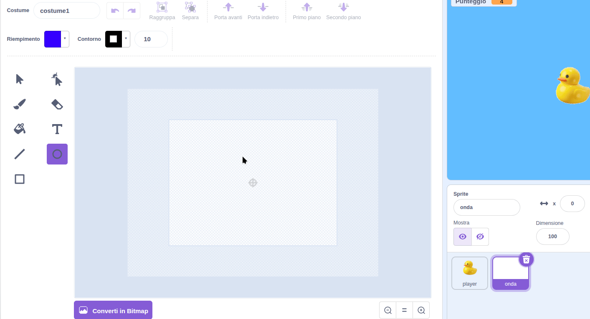
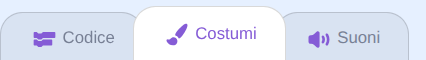
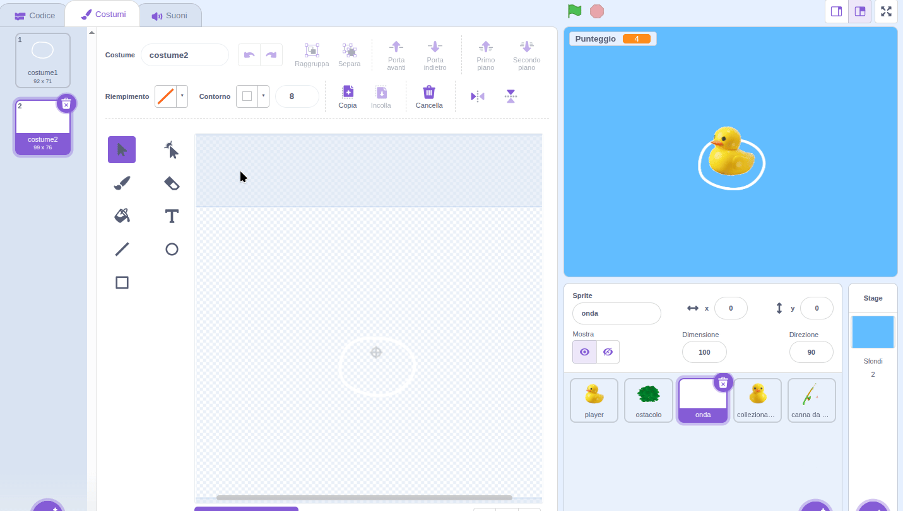

## Crea alcune onde

Per far sì che il movimento sembri davvero in acqua, puoi aggiungere un'onda che cambia man mano che l'anatra si muove.

> [!TASK]
>
> Crea un nuovo sprite con l'icona **Disegna**.
>
> {:width="250px"}

> [!TASK]
>
> Dai al tuo sprite il nome **wave**.
>
> {:width="450px"}

> [!TASK]
>
> {:width="150"}
>
> Utilizza gli strumenti di disegno per tracciare un cerchio. Questa è la forma della tua onda.
>
> Ridimensionalo quindi è un po' più grande della tua anatra. Utilizzare un colore bianco o chiaro per il contorno e rimuovere il riempimento.
>
> {:width="350"}

> [!TASK]
>
> Vai alla scheda **Codice**. Imposta l'onda con una `bandierina verde`{:class="block3events"}, inviala alla schiena e posizionala appena sotto l'anatra.
>
> ```blocks3
> when green flag clicked
> go to [back v] layer
> go to x: (0) y: (-20)
> ```

> [!TASK]
>
> Fai in modo che l'onda si muova lentamente quando non viene premuto alcun tasto.
>
> Aggiungi un blocco `se allora`{:class="block3control"} all'interno di un ciclo `per sempre`{:class="block3control"}. Nella parte `altrimenti`{:class="block3control"}, aggiungi dei blocchi per muovere l'onda su e giù, in direzione opposta rispetto all'anatra.
>
> ```blocks3
> when green flag clicked
> go to [back v] layer
> go to x: (0) y: (-20)
> forever
> +if <> then
> else
> change y by (-1)
> wait (0.3) seconds
> change y by (1)
> wait (0.3) seconds
> end
> end
> ```

**Test:** L'onda si muove nella direzione opposta rispetto all'anatra, quindi sembra che l'anatra stia galleggiando.

Ora crea una versione animata per quando l'anatra si muove.

> [!TASK]
>
> Seleziona la scheda **Costumi**.
>
> {:width="450"}

> [!TASK]
>
> **Duplica** il cerchio e ingrandisci leggermente quello nuovo, poi duplicalo di nuovo e ingrandiscilo ancora di più. Dovresti avere tre costumi in totale.
>
> {:width="450"}

> [!TASK]
>
> Trascina un `tasto premuto`{:class="block3sensing"} nel blocco `se`{:class="block3control"} e scegli **qualsiasi**.
>
> ```blocks3
> when green flag clicked
> go to [back v] layer
> go to x: (0) y: (-20)
> forever
> if <key (any v) pressed?> then
> else
> change y by (-1)
> wait (0.3) seconds
> change y by (1)
> wait (0.3) seconds
> end
> end
> ```

> [!TASK]
>
> Nella parte `se`{:class="block3control"}, aggiungi un `passa al costume seguente`{:class="block3looks"} e un `attendi`{:class="block3control"} per animare l'onda mentre l'anatra si muove.
>
> ```blocks3
> when green flag clicked
> go to [back v] layer
> go to x: (0) y: (-20)
> forever
> if <key (any v) pressed?> then
> +next costume
> +wait (0.1) seconds
> else
> change y by (-1)
> wait (0.3) seconds
> change y by (1)
> wait (0.3) seconds
> end
> end
> ```

> [!TASK]
>
> Infine, aggiungi un `passa al costume1`{:class="block3looks"} all'inizio dell'`altrimenti`{:class="block3control"}, in modo che l'onda inizi sempre dal cerchio più piccolo.
>
> ```blocks3
> when green flag clicked
> go to [back v] layer
> go to x: (0) y: (-20)
> forever
> if <key (any v) pressed?> then
> next costume
> wait (0.1) seconds
> else
> +switch costume to (costume1 v)
> change y by (-1)
> wait (0.3) seconds
> change y by (1)
> wait (0.3) seconds
> end
> end
> ```

**Test:** L'onda si muove lentamente quando non viene premuto alcun tasto e cambia quando si preme un tasto freccia.
