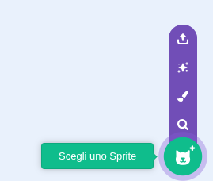
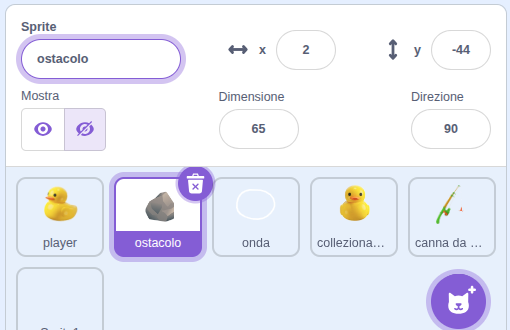
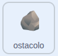
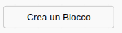

## Aggiungi rocce

In questa fase, aggiungerai delle rocce come ostacoli che la tua anatra dovrà aggirare nuotando. Le rocce si muovono sullo sfondo, dando l'impressione che l'anatra stia nuotando.

> [!TASK]
>
> Aggiungi un nuovo sprite per le tue rocce. Disegnane uno con gli strumenti di pittura oppure scegline uno dalla galleria.
>
> {:width="250"}

> [!TASK]
>
> Dai un nome al tuo sprite **ostacolo**
>
> {:width="350"}

> [!TIP]
>
> Le rocce nell'esempio sono l'emoji della roccia 🪨, copiata e incollata in una casella di testo nella scheda **Disegna**.

> [!TASK]
>
> {:width="150"}
>
> Le rocce sono fatte da **cloni**, che sono copie dello sprite. Avvia lo script con una `bandierina verde`{:class="block3events"}, nascondi lo sprite originale e crea un clone.
>
> ```blocks3
> when green flag clicked
> hide
> create clone of (myself v)
> ```

> [!TASK]
>
> Ogni roccia deve apparire in un punto casuale. Seleziona **Crea un blocco** e assegnagli il nome `apparire`{:class="block3myblocks"}.
>
> {:width="250"}

> [!TASK]
>
> Nel menu `I miei blocchi`{:class="block3myblocks"}, trascina un `definisci apparire`{:class="block3myblocks"}.
>
> ```blocks3
> define appear
> ```

> [!TASK]
>
> Sotto `definisci apparire`{:class="block3myblocks"}, aggiungi un `vai a`{:class="block3motion"} e un `mostra`{:class="block3looks"}. L'esempio usa `numero a caso tra`{:class="block3operators"} per x e y, quindi ogni rock appare in un punto diverso.
>
> ```blocks3
> define appear
> go to x: (pick random (-240) to (240)) y: (pick random (-180) to (180))
> show
> ```

> [!TASK]
>
> È anche possibile assegnare a ciascuna roccia una dimensione casuale.
>
> ```blocks3
> define appear
> go to x: (pick random (-240) to (240)) y: (pick random (-180) to (180))
> +set size to (pick random (20) to (100)) %
> show
> ```

> [!TASK]
>
> In `Quando vengo clonato`{:class="block3control"}, trascina il tuo blocco `apparire`{:class="block3myblocks"}.
>
> ```blocks3
> when I start as a clone
> appear::custom
> ```

**Test:** Clicca più volte sulla bandierina verde. Ogni volta che compare una roccia, la sua dimensione e posizione cambiano.

Le rocce devono apparire quando si premono i tasti freccia. Per farlo, attiva il clone premendo un tasto anziché la bandierina verde.

> [!TASK]
>
> Sposta il blocco `crea clone`{:class="block3control"} all'interno di un blocco `se allora`{:class="block3control"} e inserisci un blocco `tasto premuto`{:class="block3sensing"} impostato su **qualunque**.
>
> ```blocks3
> when green flag clicked
> hide
> +if <key (any v) pressed?> then
> create clone of (myself v)
> end
> ```

> [!TASK]
>
> Spostalo in un ciclo `per sempre`{:class="block3control"} per mantenerlo attivo.
>
> ```blocks3
> when green flag clicked
> hide
> +forever
> if <key (any v) pressed?> then
> create clone of (myself v)
> end
> end
> ```

**Test:** Premi i tasti freccia e vedrai comparire molte rocce in posizioni e dimensioni casuali.

Per limitare il numero di rocce clonate, aggiungi un piccolo ritardo alla fine. Ecco con quale frequenza appariranno le rocce.

> [!TASK]
>
> Aggiungi un `attendi`{:class="block3control"} con un `numero a caso tra`{:class="block3operators"}.
>
> ```blocks3
> when green flag clicked
> hide
> forever
> if <key (any v) pressed?> then
> create clone of (myself v)
> end
> +wait (pick random (1) to (3)) seconds
> end
> ```

**Test:** Premi i tasti freccia. Le rocce dovrebbero apparire in punti e dimensioni casuali, con un intervallo di 1-3 secondi tra una e l'altra.

> [!TIP]
>
> Sperimenta modificando il tempo di attesa per far apparire più o meno rocce.
