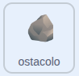

## Rocce sul bordo

In questo passaggio, farai in modo che ogni pietra inizi dal bordo rivolto verso l'anatra.

> [!TASK]
>
> {:width="150"}
>
> Aggiungi un `se allora`{:class="block3control"} con un controllo `tasto premuto`{:class="block3sensing"} impostato sulla **freccia destra** in fondo al blocco `definisci apparire`{:class="block3myblocks"},
>
> ```blocks3
> define appear
> go to x: (pick random (-240) to (240)) y: (pick random (-180) to (180))
> set size to (pick random (20) to (100)) %
> show
> +if <key (right arrow v) pressed?> then
> end
> ```

> [!TASK]
>
> Imposta la **x** a `240` in modo che inizi dal bordo destro.
>
> ```blocks3
> define appear
> go to x: (pick random (-240) to (240)) y: (pick random (-180) to (180))
> set size to (pick random (20) to (100)) %
> show
> if <key (right arrow v) pressed?> then
> +set x to (240)
> end
> ```

**Test:** Premi la freccia destra. Verifica che le rocce appaiano dal bordo destro, con il ritardo di 1-3 secondi che hai impostato in precedenza.

> [!TASK]
>
> Fate lo stesso per le altre tre direzioni.
>
> ```blocks3
> define appear
> go to x: (pick random (-240) to (240)) y: (pick random (-180) to (180))
> set size to (pick random (20) to (100)) %
> show
> if <key (right arrow v) pressed?> then
> set x to (240)
> end
> +if <key (left arrow v) pressed?> then
> set x to (-240)
> end
> +if <key (down arrow v) pressed?> then
> set y to (-180)
> end
> +if <key (up arrow v) pressed?> then
> set y to (180)
> end
> ```

**Test:** Premi tasti freccia diversi. Nuove rocce affiorano dal bordo verso cui è rivolta l'anatra.