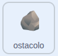
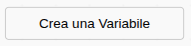
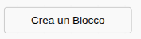

## Sposta le rocce

Le rocce si muovono sul palco, dando l'impressione che la tua anatra stia nuotando.

> [!TASK]
>
> {:width="150"}
>
> Crea una variabile chiamata `velocità roccia`{:class="block3variables"}.
>
> {:width="250"}

> [!TASK]
>
> Imposta la velocità su `3` all'inizio dello script `bandierina verde`{:class="block3events"}.
>
> ```blocks3
> when green flag clicked
> +set [rock speed v] to (3)
> hide
> forever
> if <key (any v) pressed?> then
> create clone of (myself v)
> end
> wait (pick random (1) to (3)) seconds
> end
> ```

> [!TASK]
>
> Seleziona **Crea un blocco** e chiamalo `muovere`{:class="block3myblocks"}.
>
> {:width="250"}

> [!TASK]
>
> Sotto `definisci muovere`{:class="block3myblocks"}, aggiungi un `se allora`{:class="block3control"} per la **freccia sinistra** e un `cambia x di`{:class="block3motion"} con `velocità roccia`{:class="block3variables"} al suo interno.
>
> ```blocks3
> define move
> if <key (left arrow v) pressed?> then
> change x by (rock speed)
> end
> ```

> [!TASK]
>
> Aggiungi un altro `se allora`{:class="block3control"} per la **freccia in basso**, con un `cambia y di`{:class="block3motion"} e `velocità roccia`{:class="block3variables"}.
>
> ```blocks3
> define move
> if <key (left arrow v) pressed?> then
> change x by (rock speed)
> end
> +if <key (down arrow v) pressed?> then
> change y by (rock speed)
> end
> ```

> [!TASK]
>
> Aggiungi un ciclo `per sempre`{:class="block3control"} in fondo a `quando vengo clonato`{:class="block3control"}. Vai nuovamente al menu `I miei blocchi`{:class="block3myblocks"}, e trascina il blocco `muovere`{:class="block3myblocks"}.
>
> ```blocks3
> when I start as a clone
> apparire::custom
> +forever
> muovere::custom
> end
> ```

**Test:** Tieni premuto il tasto freccia **sinistra** o **giù**. Le rocce si spostano e sembra che la tua anatra stia nuotando.

> [!TASK]
>
> La **freccia a destra** deve spostare la roccia nella direzione opposta. Aggiungi un `se allora`{:class="block3control"} per la roccia, e un `cambia x di `{:class="block3motion"}, ma questa volta usa un operatore `() - ()`{:class="block3operators"} per prendere `velocità roccia`{:class="block3variables"} lontano da `0`.
>
> ```blocks3
> define move
> if <key (left arrow v) pressed?> then
> change x by (rock speed)
> end
> if <key (down arrow v) pressed?> then
> change y by (rock speed)
> end
> +if <key (right arrow v) pressed?> then
> change x by ((0) - (rock speed))
> end
> ```

> [!TASK]
>
> Fai lo stesso per la **freccia verso l'alto**: un `cambia y di`{:class="block3motion"} che allontana `velocità roccia`{:class="block3variables"} da `0`.
>
> ```blocks3
> define move
> if <key (left arrow v) pressed?> then
> change x by (rock speed)
> end
> if <key (down arrow v) pressed?> then
> change y by (rock speed)
> end
> if <key (right arrow v) pressed?> then
> change x by ((0) - (rock speed))
> end
> +if <key (up arrow v) pressed?> then
> change y by ((0) - (rock speed))
> end
> ```

**Test:** Tieni premuto un tasto freccia. Le rocce devono scivolare nella direzione giusta in ogni direzione, in modo che sembri che la tua anatra stia nuotando.
