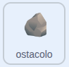

## Rimuovere le rocce

In questa fase, eliminerai ogni roccia non appena uscirà dal palco, in modo che il gioco continui a funzionare senza intoppi. Lo costruirai come un blocco `sparire`{:class="block3myblocks"}.

> [!TASK]
>
> {:width="150"}
>
> Seleziona **Crea un blocco** e chiamalo `sparire`{:class="block3myblocks"}.
>
> {:width="250"}

> [!TASK]
>
> Sotto `definisci sparire`{:class="block3myblocks"}, aggiungi un `se allora`{:class="block3control"} e trascina un blocco `e`{:class="block3operators"} al suo interno.
>
> ```blocks3
> define disappear
> if <<> and <>> then
> end
> ```

> [!TASK]
>
> Nella parte sinistra di `e`{:class="block3operators"}, inserisci un `tasto premuto`{:class="block3sensing"} impostato sulla **freccia destra**.
>
> ```blocks3
> define disappear
> if <<key (right arrow v) pressed?> and <>> then
> end
> ```

> [!TASK]
>
> Sul lato destro di `e`{:class="block3operators"}, trascina un blocco `minore`{:class="block3operators"}.
>
> ```blocks3
> define disappear
> if <<key (right arrow v) pressed?> and <() < ()>> then
> end
> ```

> [!TASK]
>
> Posiziona `posizione x`{:class="block3motion"} a sinistra e `-240` a destra.
>
> ```blocks3
> define disappear
> if <<key (right arrow v) pressed?> and <(x position) < (-240)>> then
> end
> ```

> [!TASK]
>
> Aggiungi un `elimina questo clone`{:class="block3control"} all'interno del `se`{:class="block3control"}.
>
> ```blocks3
> define disappear
> if <<key (right arrow v) pressed?> and <(x position) < (-240)>> then
> +delete this clone
> end
> ```

> [!TASK]
>
> Sotto `muovere`{:class="block3myblocks"} nel ciclo di clonazione, trascina il tuo blocco `sparire`{:class="block3myblocks"}.
>
> ```blocks3
> when I start as a clone
> apparire::custom
> forever
> muovere::custom
> +sparire::custom
> end
> ```

**Prova:** Nuota verso destra. Quando le rocce raggiungono il lato sinistro del palco, scompaiono.

> [!TASK]
>
> Duplica il blocco `se`{:class="block3control"} per gli altri 3 bordi, cambiando la chiave, le coordinate x/y e i numeri.
>
> ```blocks3
> define disappear
> if <<key (right arrow v) pressed?> and <(x position) < (-240)>> then
> delete this clone
> end
> +if <<key (left arrow v) pressed?> and <(x position) > (240)>> then
> delete this clone
> end
> +if <<key (down arrow v) pressed?> and <(y position) > (180)>> then
> delete this clone
> end
> +if <<key (up arrow v) pressed?> and <(y position) < (-180)>> then
> delete this clone
> end
> ```

**Test:** Nuota un po' in giro. Le rocce dovrebbero scomparire non appena si allontanano da un bordo e il gioco dovrebbe continuare a funzionare senza intoppi.

> [!DEBUG]
>
> A seconda delle dimensioni e della posizione del tuo costume da percorso a ostacoli, potrebbe essere necessario regolare i numeri dei bordi. Se le tue rocce scompaiono troppo presto o rimangono attaccate al bordo, prova con numeri leggermente più piccoli o più grandi (ad esempio `-220` o `-260` invece di `-240`).
