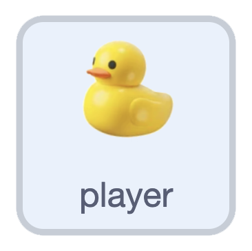
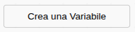
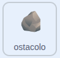

## Blocca l'anatra

In questo momento la tua anatra nuota dritta tra le rocce. In questa fase, farai in modo che le rocce blocchino il suo percorso.

> [!TASK]
>
> {:width="150"}
>
> Nello sprite del **giocatore**, crea 4 variabili: `destra bloccata`{:class="block3variables"}, `sinistra bloccata`{:class="block3variables"}, `su bloccato`{:class="block3variables"} e `giù bloccato`{:class="block3variables"}. Deseleziona le relative caselle di controllo in modo che non vengano visualizzate sullo stage.
>
> {:width="250"}

Hai creato questo script `passa al costume seguente`{:class="block3looks"} per la freccia destra nel passaggio 2:

```blocks3
if <key (right arrow v) pressed?> then
switch costume to (right v)
end
```

> [!TASK]
>
> Sotto il blocco `passa al costume`{:class="block3looks"}, aggiungi un blocco `se allora`{:class="block3control"}. Trascina un elemento `sta toccando?`{:class="block3sensing"} e scegli **ostacolo**.
>
> ```blocks3
> if <key (right arrow v) pressed?> then
> switch costume to (right v)
> +if <touching (obstacle v)?> then
> else
> end
> end
> ```

> [!TASK]
>
> Quando tocca una roccia, aggiungi un blocco `porta destra bloccata`{:class="block3variables"} e impostalo su `sì`.
>
> ```blocks3
> if <key (right arrow v) pressed?> then
> switch costume to (right v)
> if <touching (obstacle v)?> then
> +set [right blocked v] to [yes]
> else
> end
> end
> ```

> [!TASK]
>
> Aggiungi `attendi 0.5 secondi`{:class="block3control"} dopo.
>
> ```blocks3
> if <key (right arrow v) pressed?> then
> switch costume to (right v)
> if <touching (obstacle v)?> then
> set [right blocked v] to [yes]
> +wait (0.5) seconds
> else
> end
> end
> ```

> [!TASK]
>
> Fai lo stesso nel blocco `altrimenti`{:class="block3control"}: aggiungi un blocco `porta destra bloccata`{:class="block3variables"} e impostalo su `no`.
>
> ```blocks3
> if <key (right arrow v) pressed?> then
> switch costume to (right v)
> if <touching (obstacle v)?> then
> set [right blocked v] to [yes]
> wait (0.5) seconds
> else
> +set [right blocked v] to [no]
> end
> end
> ```

> [!TIP]
>
> L'opzione `attendi 0.5 secondi`{:class="block3control"} ti dà un attimo per cambiare direzione dopo aver urtato una roccia.

> [!TASK]
>
> Fai lo stesso per gli altri tre tasti freccia, usando `sinistra bloccata`{:class="block3variables"}, `su bloccata`{:class="block3variables"} e `downgiù bloccato`{:class="block3variables"}.

Ora aggiungi le variabili di blocco alla roccia, in modo che smetta di muoversi quando viene bloccata.

> [!TASK]
>
> {:width="150"}
>
> Vai al tuo sprite **roccia**. Nel blocco `muovere`{:class="block3myblocks"}, aggiungi un blocco `e`{:class="block3operators"} e trascina il blocco `tasto premuto`{:class="block3sensing"} nella casella a sinistra.
>
> ```blocks3
> define move
> +if <<key (right arrow v) pressed?> and <>> then
> change x by ((0) - (rock speed))
> end
> ```

> [!TASK]
>
> Trascina un blocco `uguale`{:class="block3operators"} nel blocco `e`{:class="block3operators"}.
>
> ```blocks3
> define move
> if <<key (right arrow v) pressed?> and <() = ()>> then
> change x by ((0) - (rock speed))
> end
> ```

> [!TASK]
>
> Metti `destra bloccata`{:class="block3variables"} a sinistra e `no` a destra, così la roccia si muove solo quando si preme la freccia destra e la destra non è bloccata.
>
> ```blocks3
> define move
> if <<key (right arrow v) pressed?> and <(right blocked) = [no]>> then
> change x by ((0) - (rock speed))
> end
> ```

> [!TASK]
>
> Duplica l'operazione e ripeti la stessa procedura per ciascuno dei tasti freccia.
>
> ```blocks3
> define move
> if <<key (right arrow v) pressed?> and <(right blocked) = [no]>> then
> change x by ((0) - (rock speed))
> end
> +if <<key (left arrow v) pressed?> and <(left blocked) = [no]>> then
> change x by (rock speed)
> end
> +if <<key (down arrow v) pressed?> and <(down blocked) = [no]>> then
> change y by (rock speed)
> end
> +if <<key (up arrow v) pressed?> and <(up blocked) = [no]>> then
> change y by ((0) - (rock speed))
> end
> ```

**Prova:** Nuota contro uno scoglio. La tua anatra dovrebbe fermarsi invece di nuotarci sopra.

> [!DEBUG]
>
> L'opzione `attendi 0.5 secondi`{:class="block3control"} offre una breve finestra di tempo per sterzare dopo un urto, ma se la tua anatra si blocca su una roccia e non riesce a muoversi, è perché i 2 costumi si sovrappongono.
>
> Prova a spostare il punto centrale del costume della tua anatra nell'editor di pittura, oppure a ridurre leggermente le dimensioni dello sprite, e fai delle prove finché l'anatra non riesce sempre a nuotare via da una collisione.
