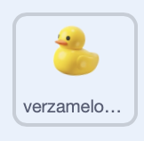
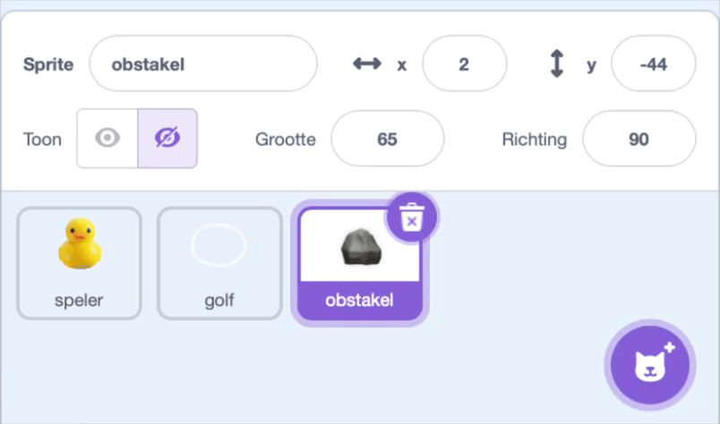
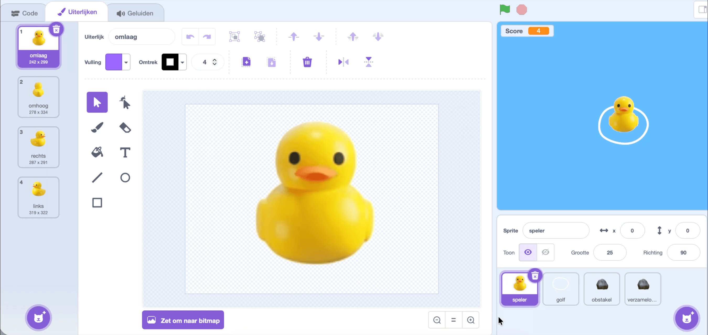
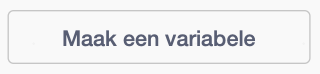
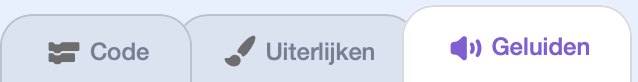
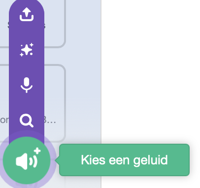

## Verzamelobjecten

In deze stap verzamel je de verloren eendjes om punten te verdienen. Je kunt de rots-sprite dupliceren en de blokken ervan hergebruiken.

> [!TASK]
>
> {:width="150"}
>
> Klik met de rechtermuisknop op je **rots**-sprite en dupliceer deze. Geef de kopie de naam **verzamelobject**.
>
> {:width="450"}

> [!TASK]
>
> Geef het een eendenuiterlijk. Kopieer er een van je eend-sprite, of maak zelf een andere.
>
> {:width="450"}

> [!TASK]
>
> In `wanneer ik als kloon start`{:class="block3control"} voeg je onder het `verdwijn`{:class="block3myblocks"} blok een `als dan`{:class="block3control"} blok toe en sleep je een `raak ik?`{:class="block3sensing"} erin. Kies **speler** uit de keuzelijst.
>
> ```blocks3
> when I start as a clone
> verschijn::custom
> forever
> beweeg::custom
> verdwijn::custom
> +if <touching (speler v)?> then
> end
> end
> ```

> [!TASK]
>
> Maak een variabele met de naam `score`{:class="block3variables"} en vink het bijbehorende selectievakje aan zodat deze op het scherm verschijnt.
>
> {:width="300"}

> [!TASK]
>
> Zet `score`{:class="block3variables"} op `0` aan het begin van het `groene vlag`{:class="block3events"} script, zodat het bij elk spel gereset wordt.
>
> ```blocks3
> when green flag clicked
> set [snelheid van de rots v] to (3)
> +set [score v] to (0)
> hide
> forever
> if <key (willekeurig v) pressed?> then
> create clone of (mijzelf v)
> end
> wait (pick random (1) to (3)) seconds
> end
> ```

> [!TASK]
>
> Voeg een `verander score met 1`{:class="block3variables"} blok toe zodat de score omhoog gaat wanneer een eendje wordt verzameld.
>
> ```blocks3
> forever
> beweeg::custom
> verdwijn::custom
> if <touching (speler v)?> then
> +change [score v] by (1)
> end
> end
> ```

> [!TASK]
>
> Maak een geluid voor het verzamelen van een eend. Open het tabblad **Geluiden**.
>
> {:width="450"}

> [!TASK]
>
> Klik op **Kies een geluid** en kies er een uit de bibliotheek.
>
> {:width="250"}

> [!TASK]
>
> Ga terug naar het tabblad **Code**, voeg een `start geluid`{:class="block3sound"} blok toe en kies je geluid.
>
> ```blocks3
> forever
> beweeg::custom
> verdwijn::custom
> if <touching (speler v)?> then
> change [score v] by (1)
> +start sound (Glug v)
> end
> end
> ```

> [!TASK]
>
> `Verwijder deze kloon`{:class="block3control"} tot slot, zodat het lijkt alsof de eend is verzameld.
>
> ```blocks3
> forever
> beweeg::custom
> verdwijn::custom
> if <touching (speler v)?> then
> change [score v] by (1)
> start sound (Glug v)
> +delete this clone
> end
> end
> ```

**Test:** Zwem tegen een eend aan. Je score zou omhoog moeten gaan en de eend moet verdwijnen met een geluid.
