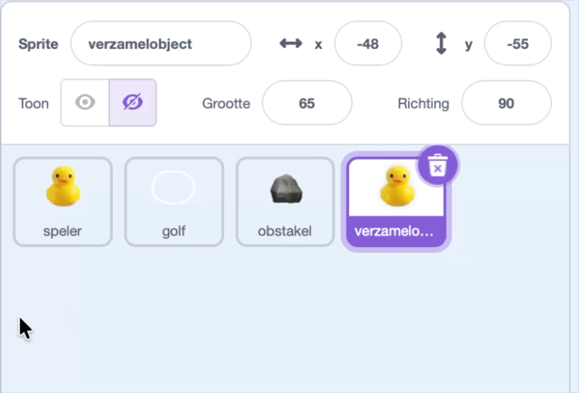
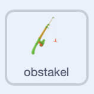
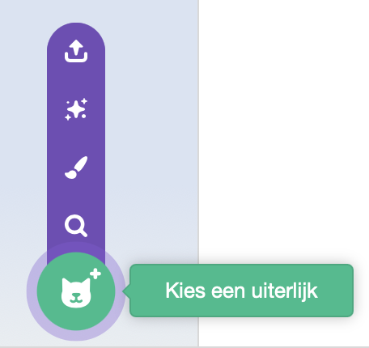
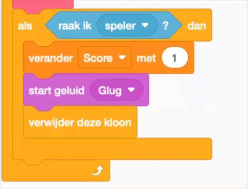
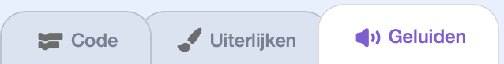
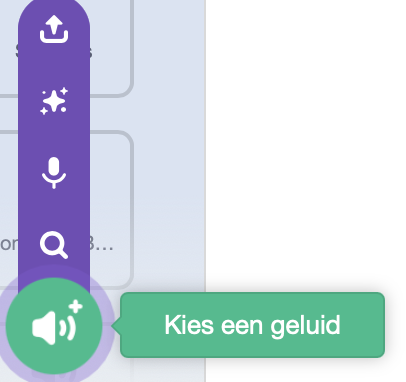

## Voeg een obstakel toe

In deze stap voeg je een obstakel toe dat je eend moet ontwijken, anders is het spel afgelopen. In het voorbeeld wordt een haak gebruikt, maar het kan ook een ander dier zijn, afval in het water, of iets anders dat jij kiest.

> [!TASK]
>
> Klik met de rechtermuisknop op je **verzamelbare** sprite en dupliceer deze. Hernoem de kopie **obstakel**.
>
> {:width="450"}

> [!TASK]
>
> {:width="150"}
>
> Verander het uiterlijk. Kies er een uit de bibliotheek of upload je eigen haakafbeelding.
>
> {:width="300"}

> [!TASK]
>
> Een obstakel mag geen punten opleveren. Klik met de rechtermuisknop op het `verander score met ()`{:class="block3variables"} blok en verwijder het.
>
> {:width="450"}

> [!TASK]
>
> Geef je obstakel een ander geluid. Open het tabblad **Geluiden**.
>
> {:width="450"}

> [!TASK]
>
> Klik op **Kies een geluid** en kies er een uit de bibliotheek. De haak maakt een "scheurend" (Rip) geluid.
>
> {:width="250"}

> [!TASK]
>
> Ga terug naar het tabblad **Code**, en verander het `start geluid`{:class="block3sound"} blok naar je nieuwe geluid.
>
> ```blocks3
> when I start as a clone
> appear::custom
> forever
> move::custom
> disappear::custom
> if <touching (player v)?> then
> +start sound (Rip v)
> delete this clone
> end
> end
> ```

> [!TASK]
>
> Zorg er nu voor dat het spel eindigt wanneer het obstakel je eend te pakken krijgt. Verander `verwijder deze kloon`{:class="block3control"} naar een `stop alle`{:class="block3control"} blok, en voeg een kort `wacht () sec.`{:class="block3control"} blok toe zodat het geluid kan eindigen.
>
> ```blocks3
> when I start as a clone
> appear::custom
> forever
> move::custom
> disappear::custom
> if <touching (player v)?> then
> start sound (Rip v)
> +wait (0.2) seconds
> +stop [all v]
> end
> end
> ```

**Test:** Zwem rond en controleer of het spel eindigt wanneer je eend te pakken wordt genomen door het obstakel.

> [!TASK]
>
> Om het moeilijker te maken, stuur je elk obstakel vanuit een willekeurige richting. Voeg in je `verschijn`{:class="block3myblocks"} blok een `richt naar () graden`{:class="block3motion"} toe en zet in het vakje een `willekeurig getal tussen () en ()`{:class="block3operators"} blok.
>
> ```blocks3
> define appear
> +point in direction (pick random (-180) to (180))
> go to x: (pick random (-240) to (240)) y: (pick random (-180) to (180))
> set size to (pick random (20) to (100)) %
> show
> ```

> [!TIP]
>
> In het voorbeeld wordt een hoek van `-180` tot `180` graden gebruikt, maar je kunt experimenteren met het bereik.

> [!TASK]
>
> `Richt naar graden`{:class="block3motion"} draait alleen het obstakel. Om het die kant op te laten bewegen, voeg je een `beweeg`{:class="block3motion"} blok toe, ingesteld op `3` stappen, in de kloonlus.
>
> ```blocks3
> when I start as a clone
> appear::custom
> forever
> move::custom
> disappear::custom
> if <touching (player v)?> then
> start sound (Rip v)
> wait (0.2) seconds
> stop [all v]
> end
> +move (3) steps
> end
> ```

**Test:** De obstakels moeten ronddrijven en het spel moet eindigen wanneer je eend er tegenaan botst.
