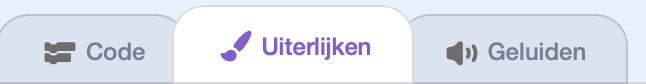
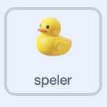
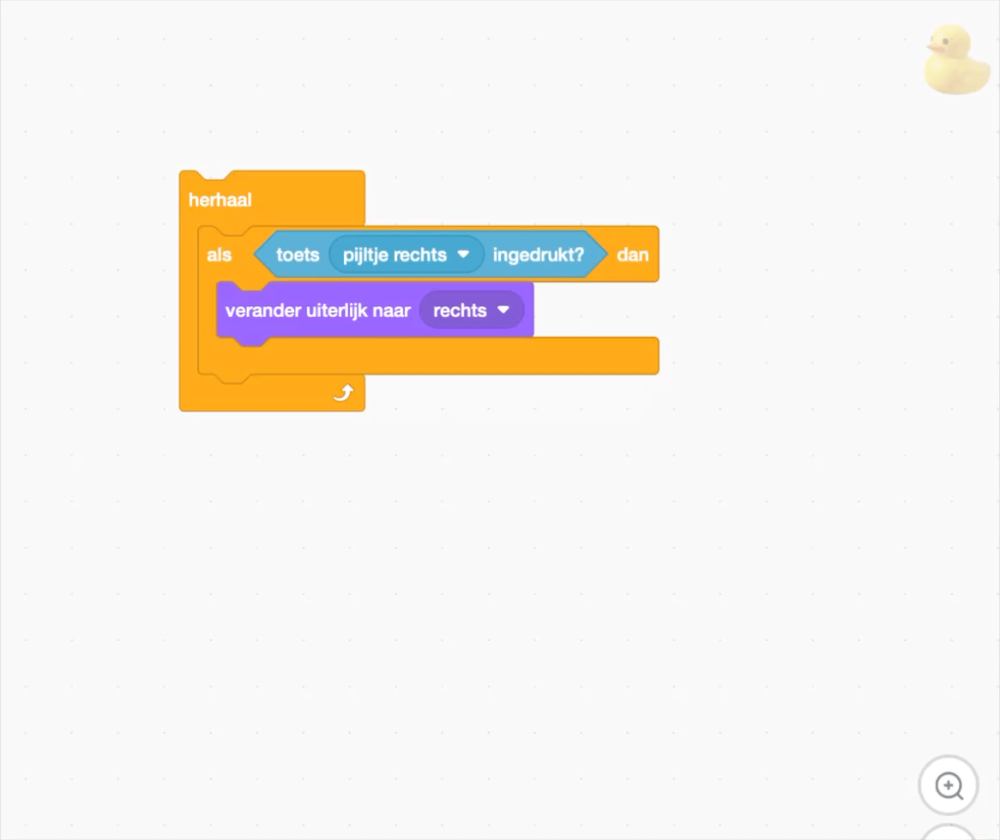

## Verplaats de eend

In deze stap gebruik je de pijltjestoetsen om de eend te laten draaien.

> [!TASK]
>
> Open het [startproject](https://scratch.mit.edu/projects/1366224959/editor){:target="_blank"}. Log in op je Scratch-account en selecteer vervolgens **remix**.
>
> {:width="200"}

> [!TIP]
>
> De **remix**-knop verschijnt alleen als je bent ingelogd.

Je eend staat al op het Speelveld. De sprite heet **speler**. Andere sprites zullen deze naam later gebruiken om te controleren of ze de eend raken.

> [!TASK]
>
> Open het tabblad **Uiterlijken** de uiterlijken van je eend te bekijken. Deze zijn aangeduid met omhoog, omlaag, links en rechts.
>
> {:width="450"}

> [!TIP]
>
> Als je liever je eigen sprite gebruikt, kun je er een **kiezen**, **tekenen** of **uploaden**. Er is een uiterlijk nodig voor elke richting: omhoog, omlaag, naar links en naar rechts.

> [!TASK]
>
> {:width="100px"}
>
> Ga terug naar het **codetabblad** en stel de startpositie in. Voeg een `groene vlag`{:class="block3events"} blok toe. Breng de eend naar de `voorgrondr`{:class="block3looks"}, `verander uiterlijk`{:class="block3looks"} naar beneden en plaats hem in het midden van het speelveld.
>
> ```blocks3
> when green flag clicked
> go to [front v] layer
> switch costume to (down v)
> go to x: (0) y: (0)
> ```

Gebruik de pijltjestoetsen om de eend te draaien.

> [!TASK]
>
> Voeg een `herhaal`{:class="block3control"} lus toe met een `als dan`{:class="block3control"} blok erin. Sleep een `toets ingedrukt`{:class="block3sensing"} en kies een pijltje rechts.
>
> ```blocks3
> when green flag clicked
> go to [front v] layer
> switch costume to (down v)
> go to x: (0) y: (0)
> +forever
> if <key (right arrow v) pressed?> then
> end
> end
> ```

> [!TASK]
>
> Voeg binnen het `als`{:class="block3control"} blok, een `verander uiterlijk`{:class="block3looks"} blok toe zodat de eend naar rechts kijkt.
>
> ```blocks3
> forever
> if <key (right arrow v) pressed?> then
> +switch costume to (right v)
> end
> end
> ```

> [!TASK]
>
> Doe hetzelfde voor de andere drie toetsen: `pijltje links `{:class="block3sensing"} → links, `pijltje omlaag`{:class="block3sensing"} → omlaag, en `pijltje omhoog`{:class="block3sensing"} → omhoog.
>
> ```blocks3
> forever
> if <key (right arrow v) pressed?> then
> switch costume to (right v)
> end
> +if <key (left arrow v) pressed?> then
> switch costume to (left v)
> end
> +if <key (down arrow v) pressed?> then
> switch costume to (down v)
> end
> +if <key (up arrow v) pressed?> then
> switch costume to (up v)
> end
> end
> ```

> [!TIP]
>
> Je kunt met de rechtermuisknop op een blok klikken om het te dupliceren.
>
> {:width="450"}

**Test:** Druk op de pijltjestoetsen en controleer of je eend draait.
