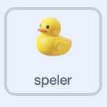
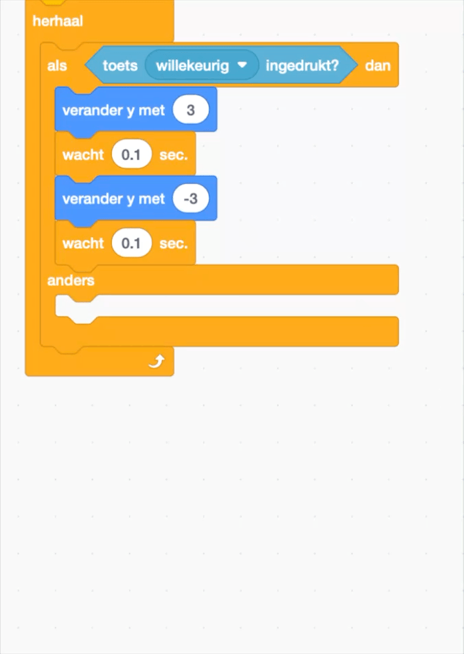

## Drijf op het water

In deze stap laat je je eendje op het water drijven.

Begin door de eend op en neer te laten gaan wanneer er een toets wordt ingedrukt.

> [!TASK]
>
> {:width="100px"}
>
> Voeg een tweede `groene vlag`{:class="block3events"} blok toe met een `herhaal`{:class="block3control"} lus en een `als dan anders`{:class="block3control"} blok erin.
>
> ```blocks3
> when green flag clicked
> forever
> if <> then
> else
> end
> end
> ```

> [!TASK]
>
> Sleep een `toets ingedrukt?`{:class="block3sensing"} blok naar het `als`{:class="block3control"} en kies **willekeurig** uit de keuzelijst.
>
> ```blocks3
> when green flag clicked
> forever
> +if <key (any v) pressed?> then
> else
> end
> end
> ```

> [!TASK]
>
> In het `als`{:class="block3control"} deel, laat je je eend snel bewegen terwijl een toets wordt ingedrukt.
>
> ```blocks3
> when green flag clicked
> forever
> if <key (any v) pressed?> then
> +change y by (3)
> +wait (0.1) seconds
> +change y by (-3)
> +wait (0.1) seconds
> else
> end
> end
> ```

> [!TASK]
>
> Om de eend langzaam te laten bewegen wanneer er geen toets wordt ingedrukt, gebruik je dezelfde blokken, maar dan kleiner en langzamer. Klik met de rechtermuisknop op de blokken die je zojuist hebt gemaakt om ze te dupliceren en sleep de kopie naar het `anders`{:class="block3control"}-gedeelte.
>
> {:width="450"}

> [!TASK]
>
> Verander de waarden zodat de bewegingen van de eend kleiner en langzamer worden.
>
> ```blocks3
> when green flag clicked
> forever
> if <key (any v) pressed?> then
> change y by (3)
> wait (0.1) seconds
> change y by (-3)
> wait (0.1) seconds
> else
> +change y by (1)
> +wait (0.3) seconds
> +change y by (-1)
> +wait (0.3) seconds
> end
> end
> ```

**Test:** Klik op de groene vlag. Je eendje beweegt rustig en vanzelf op en neer, en beweegt sneller als je op een pijltjestoets drukt.