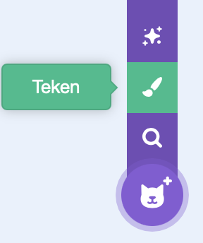
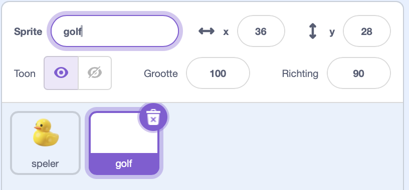
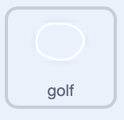
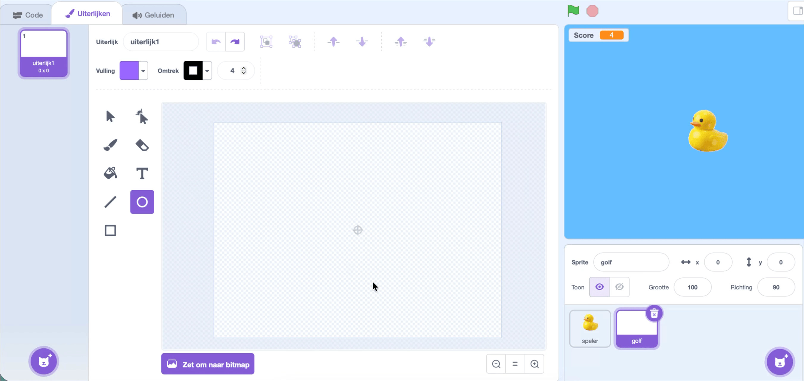
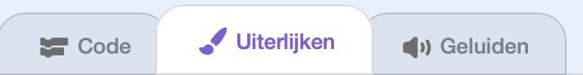
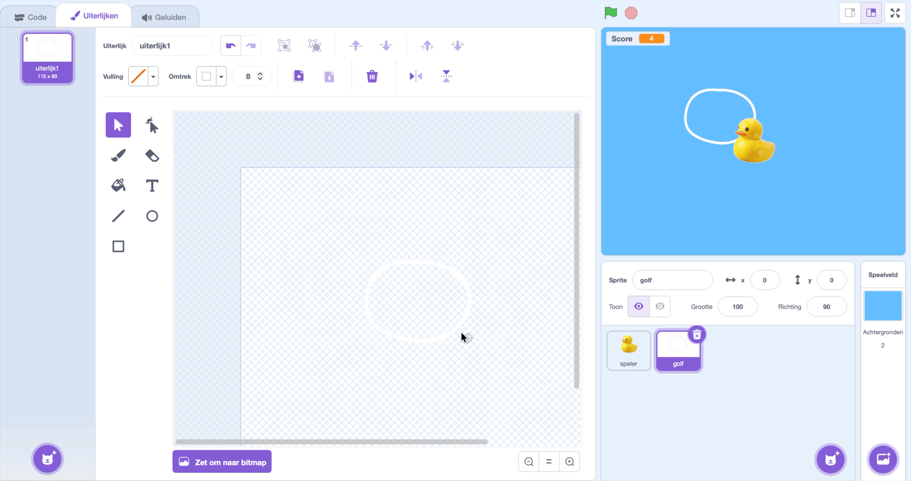

## Maak wat golven

Om ervoor te zorgen dat de beweging er echt uitziet, kun je een golf toevoegen die verandert terwijl de eend beweegt.

> [!TASK]
>
> Maak een nieuwe sprite met het **Teken**-sprite-icoon.
>
> {:width="250"}

> [!TASK]
>
> Geef je sprite de naam **golf**.
>
> {:width="450"}

> [!TASK]
>
> {:width="150"}
>
> Gebruik de tekengereedschappen om een cirkel te tekenen. Dit is de vorm van je golf.
>
> Verander het formaat zodat hij een beetje groter is dan je eend. Gebruik een witte of lichtgekleurde omtrek en verwijder de vulling.
>
> {:width="350"}

> [!TASK]
>
> Ga naar het tabblad **Code**. Stel de golf in met een `groene vlag`{:class="block3events"}, stuur het naar de achtergrond, en plaats hem net onder de eend.
>
> ```blocks3
> when green flag clicked
> go to [back v] layer
> go to x: (0) y: (-20)
> ```

> [!TASK]
>
> Laat de golf langzaam bewegen wanneer er geen toets wordt ingedrukt.
>
> Voeg een `als dan anders`{:class="block3control"} blok toe in een `herhaal`{:class="block3control"} lus. Voeg in het `anders`{:class="block3control"}-gedeelte blokken toe om de golf op en neer te laten bewegen, in de tegenovergestelde richting van de eend.
>
> ```blocks3
> when green flag clicked
> go to [back v] layer
> go to x: (0) y: (-20)
> forever
> +if <> then
> else
> change y by (-1)
> wait (0.3) seconds
> change y by (1)
> wait (0.3) seconds
> end
> end
> ```

**Test:** De golf beweegt in de tegenovergestelde richting van je eend, waardoor het lijkt alsof de eend drijft.

Maak nu een geanimeerde versie voor wanneer de eend beweegt.

> [!TASK]
>
> Selecteer de **Uiterlijken** tab.
>
> {:width="450"}

> [!TASK]
>
> **Dupliceer** de cirkel en maak de nieuwe iets groter, dupliceer hem vervolgens nogmaals en maak hem nog groter. Je zou in totaal drie uiterlijken moeten hebben.
>
> {:width="450"}

> [!TASK]
>
> Sleep een `toets ingedrukt?`{:class="block3sensing"} blok naar het `als`{:class="block3control"} en kies **willekeurig** uit de keuzelijst.
>
> ```blocks3
> when green flag clicked
> go to [back v] layer
> go to x: (0) y: (-20)
> forever
> if <key (any v) pressed?> then
> else
> change y by (-1)
> wait (0.3) seconds
> change y by (1)
> wait (0.3) seconds
> end
> end
> ```

> [!TASK]
>
> In het `als`{:class="block3control"} deel voeg je een `volgend uiterlijk`{:class="block3looks"} blok en een `wacht`{:class="block3control"} blok toe om animatie toe te voegen aan de golf terwijl de eend beweegt.
>
> ```blocks3
> when green flag clicked
> go to [back v] layer
> go to x: (0) y: (-20)
> forever
> if <key (any v) pressed?> then
> +next costume
> +wait (0.1) seconds
> else
> change y by (-1)
> wait (0.3) seconds
> change y by (1)
> wait (0.3) seconds
> end
> end
> ```

> [!TASK]
>
> Voeg ten slotte een `verander uiterlijk naar het uiterlijk1`{:class="block3looks"} blok toe boven aan het `anders`{:class="block3control"} blok, zodat de golf altijd begint bij de kleinste cirkel.
>
> ```blocks3
> when green flag clicked
> go to [back v] layer
> go to x: (0) y: (-20)
> forever
> if <key (any v) pressed?> then
> next costume
> wait (0.1) seconds
> else
> +switch costume to (costume1 v)
> change y by (-1)
> wait (0.3) seconds
> change y by (1)
> wait (0.3) seconds
> end
> end
> ```

**Test:** De golf beweegt langzaam als er geen toetsen worden ingedrukt en verandert wanneer je een pijltje indrukt.
