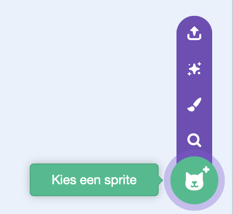
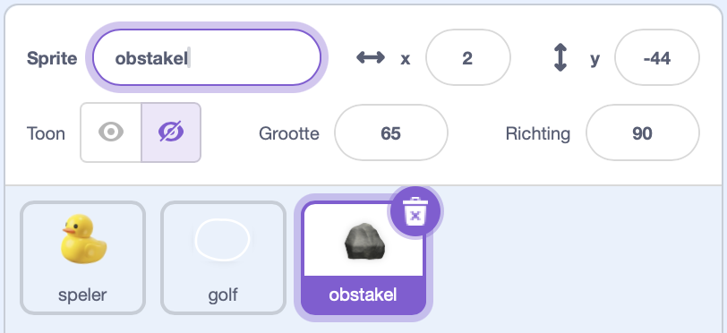
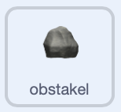
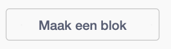

## Voeg rotsen toe

In deze stap voeg je rotsen toe als obstakels waar je eend omheen moet zwemmen. De rotsen op de achtergrond bewegen, waardoor het eruit ziet alsof de eend zwemt.

> [!TASK]
>
> Voeg een nieuwe sprite toe voor je rotsen. Teken er zelf een met de tekengereedschappen, of kies er een uit de bibliotheek.
>
> {:width="250"}

> [!TASK]
>
> Geef je sprite de naam **obstakel**
>
> {:width="350"}

> [!TIP]
>
> De rotsen in het voorbeeld zijn de rots-emoji 🪨, die gekopieerd en geplakt is in een tekstvak in het **Teken**-tabblad.

> [!TASK]
>
> {:width="150"}
>
> De rotsen zijn gemaakt van **klonen**, dat zijn kopieën van de sprite. Begin het script met een `groene vlag`{:class="block3events"}, verberg de oorspronkelijke sprite en maak een kloon.
>
> ```blocks3
> when green flag clicked
> hide
> create clone of (myself v)
> ```

> [!TASK]
>
> Elke rots moet op een willekeurige plek verschijnen. Selecteer **Maak een blok** en noem het `verschijn`{:class="block3myblocks"}.
>
> {:width="250"}

> [!TASK]
>
> In het `Mijn blokken`{:class="block3myblocks"} menu sleep je een `definieer verschijn`{:class="block3myblocks"} blok.
>
> ```blocks3
> define appear
> ```

> [!TASK]
>
> Onder `definieer verdwijn`{:class="block3myblocks"} blok, voeg je een `ga naar`{:class="block3motion"} en een `verschijn`{:class="block3looks"} blok toe. Dit voorbeeld gebruikt `willekeurig getal tussen () en ()`{:class="block3operators"} voor x en y, dus elke rots verschijnt op een andere plek.
>
> ```blocks3
> define appear
> go to x: (pick random (-240) to (240)) y: (pick random (-180) to (180))
> show
> ```

> [!TASK]
>
> Je kunt elke rots ook een willekeurige grootte geven.
>
> ```blocks3
> define appear
> go to x: (pick random (-240) to (240)) y: (pick random (-180) to (180))
> +set size to (pick random (20) to (100)) %
> show
> ```

> [!TASK]
>
> Sleep in het `wanneer ik als kloon start`{:class="block3control"} blok je `verschijn`{:class="block3myblocks"} blok.
>
> ```blocks3
> when I start as a clone
> appear::custom
> ```

**Test:** Klik een paar keer op de groene vlag. Elke keer verschijnt er een rotsblok op een andere plek en met een andere grootte.

De rotsen moeten verschijnen wanneer je op de pijltjestoetsen drukt. Activeer de kloon met een ingedrukte toets in plaats van de groene vlag.

> [!TASK]
>
> Verplaats het `maak kloon`{:class="block3control"} blok naar een `als dan`{:class="block3control"} blok, en zet een `toets ingedrukt`{:class="block3sensing"} blok ingesteld op **willekeurig** in het vakje na als.
>
> ```blocks3
> when green flag clicked
> hide
> +if <key (any v) pressed?> then
> create clone of (myself v)
> end
> ```

> [!TASK]
>
> Verplaats dit naar een `herhaal`{:class="block3control"} lus om het door te laten gaan.
>
> ```blocks3
> when green flag clicked
> hide
> +forever
> if <key (any v) pressed?> then
> create clone of (myself v)
> end
> end
> ```

**Test:** Druk op de pijltoetsen en zie heel veel rotsen verschijnen op diverse plekken en met willekeurige groottes.

Om het aantal te klonen rotsen te beperken, voeg je een kleine vertraging toe aan het eind. Dit is hoe vaak de rotsen zullen verschijnen.

> [!TASK]
>
> Voeg een `wacht sec`{:class="block3control"} toe met daarin een `willekeurig getal tussen () en ()`{:class="block3operators"} blok.
>
> ```blocks3
> when green flag clicked
> hide
> forever
> if <key (any v) pressed?> then
> create clone of (myself v)
> end
> +wait (pick random (1) to (3)) seconds
> end
> ```

**Test:** Druk op de pijltjestoetsen. De rotsen moeten op willekeurige plekken en in verschillende groottes verschijnen, met een wachttijd van 1 tot 3 seconden tussen elke steen.

> [!TIP]
>
> Experimenteer met de wachttijd om meer of minder rotsen te laten verschijnen.
