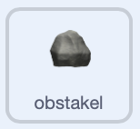

## Rotsen aan de rand

In deze stap laat je elke rots aan de rand beginnen waar de eend naartoe kijkt.

> [!TASK]
>
> {:width="150"}
>
> Voeg een `als dan`{:class="block3control"} blok toe met een `toets ingedrukt?`{:class="block3sensing"} controle die is ingesteld op \*\*pijltje rechts \*\* aan de onderkant van het `definieer verschijn`{:class="block3myblocks"} blok,
>
> ```blocks3
> define appear
> go to x: (pick random (-240) to (240)) y: (pick random (-180) to (180))
> set size to (pick random (20) to (100)) %
> show
> +if <key (right arrow v) pressed?> then
> end
> ```

> [!TASK]
>
> Zet **x** op `240` zodat hij aan de rechterrand begint.
>
> ```blocks3
> define appear
> go to x: (pick random (-240) to (240)) y: (pick random (-180) to (180))
> set size to (pick random (20) to (100)) %
> show
> if <key (right arrow v) pressed?> then
> +set x to (240)
> end
> ```

**Test:** Druk op de pijltje naar rechts toets. Controleer of de rotsen aan de rechterrand verschijnen, met de 1 tot 3 seconden vertraging die je eerder hebt ingesteld.

> [!TASK]
>
> Doe hetzelfde voor de andere drie richtingen.
>
> ```blocks3
> define appear
> go to x: (pick random (-240) to (240)) y: (pick random (-180) to (180))
> set size to (pick random (20) to (100)) %
> show
> if <key (right arrow v) pressed?> then
> set x to (240)
> end
> +if <key (left arrow v) pressed?> then
> set x to (-240)
> end
> +if <key (down arrow v) pressed?> then
> set y to (-180)
> end
> +if <key (up arrow v) pressed?> then
> set y to (180)
> end
> ```

**Test:** Druk op verschillende pijltjestoetsen. Aan de rand waar de eend naartoe kijkt, verschijnen nieuwe rotsen.