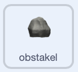
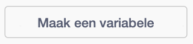
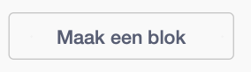

## Verplaats de rotsen

De rotsen bewegen over het speelvel, waardoor het lijkt alsof je eendje zwemt.

> [!TASK]
>
> {:width="150"}
>
> Maak een variabele met de naam `snelheid van de rots`{:class="block3variables"}.
>
> {:width="250"}

> [!TASK]
>
> Zet de snelheid op `3` aan het begin van het `groene vlag`{:class="block3events"} script.
>
> ```blocks3
> when green flag clicked
> +set [rock speed v] to (3)
> hide
> forever
> if <key (any v) pressed?> then
> create clone of (myself v)
> end
> wait (pick random (1) to (3)) seconds
> end
> ```

> [!TASK]
>
> Selecteer **Maak een blok** en noem het `beweging`{:class="block3myblocks"}.
>
> {:width="250"}

> [!TASK]
>
> Onder `definieer beweging`{:class="block3myblocks"}, voeg je een `als dan`{:class="block3control"} toe voor de \*\*pijltje links \*\* toets ingedrukt, en een `verander x met`{:class="block3motion"} met daarin`snelheid van de rots`{:class="block3variables"}.
>
> ```blocks3
> define move
> if <key (left arrow v) pressed?> then
> change x by (rock speed)
> end
> ```

> [!TASK]
>
> Voeg nog een `als dan`{:class="block3control"} toe voor de **pijltje omlaag**, met een `verander y door`{:class="block3motion"} en daarin de`snelheid van de de rots`{:class="block3variables"} variabele.
>
> ```blocks3
> define move
> if <key (left arrow v) pressed?> then
> change x by (rock speed)
> end
> +if <key (down arrow v) pressed?> then
> change y by (rock speed)
> end
> ```

> [!TASK]
>
> Voeg een `herhaal`{:class="block3control"} lus toe onderdaan het `wanneer ik als kloon begin`{:class="block3control"} script. Ga opnieuw naar het `Mijn blokken`{:class="block3myblocks"} menu en sleep je `beweging`{:class="block3myblocks"} blok erin.
>
> ```blocks3
> when I start as a clone
> appear::custom
> +forever
> move::custom
> end
> ```

**Test:** Houd de **pijltje naar links** of de **pijltje naar beneden** toets ingedrukt. De rotsen drijven rond en het lijkt alsof je eendje zwemt.

> [!TASK]
>
> De **pijltje naar rechts** toets moet de rots de andere kant op laten bewegen. Voeg een `als dan`{:class="block3control"} blok toe voor de rots, en een `verander x met`{:class="block3motion"}, maar deze tijd gebruikt een `() - ()`{:class="block3operators"} operator om de `snelheid van de rots speed`{:class="block3variables"} van `0` af te halen.
>
> ```blocks3
> define move
> if <key (left arrow v) pressed?> then
> change x by (rock speed)
> end
> if <key (down arrow v) pressed?> then
> change y by (rock speed)
> end
> +if <key (right arrow v) pressed?> then
> change x by ((0) - (rock speed))
> end
> ```

> [!TASK]
>
> Doe hetzelfde voor het **pijltje omhoog**: een `verander y met`{:class="block3motion"} die de `snelheid van de rots`{:class="block3variables"} van `0` afhaalt.
>
> ```blocks3
> define move
> if <key (left arrow v) pressed?> then
> change x by (rock speed)
> end
> if <key (down arrow v) pressed?> then
> change y by (rock speed)
> end
> if <key (right arrow v) pressed?> then
> change x by ((0) - (rock speed))
> end
> +if <key (up arrow v) pressed?> then
> change y by ((0) - (rock speed))
> end
> ```

**Test:** Houd een pijltjestoets ingedrukt. De stenen moeten in alle richtingen de goede kant op schuiven, zodat het lijkt alsof je eend aan het zwemmen is.
