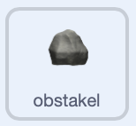

## Verwijder de rotsen

In deze stap verwijder je elke rots zodra deze van het speelveld afdrijft, zodat je spel soepel blijft lopen. Je bouwt dit als een `verdwijn`{:class="block3myblocks"} blok.

> [!TASK]
>
> {:width="150"}
>
> Selecteer **Maak een blok** en geef het de naam `verdwijn`{:class="block3myblocks"}.
>
> {:width="250"}

> [!TASK]
>
> Onder `definieer verdwijn`{:class="block3myblocks"}, voeg je een `als dan`{:class="block3control"} blok toe en sleep een `en`{:class="block3operators"} operator erin.
>
> ```blocks3
> define disappear
> if <<> and <>> then
> end
> ```

> [!TASK]
>
> Plaats aan de linkerkant van de `en`{:class="block3operators"}, een `toets ingedrukt?`{:class="block3sensing"} blok voor de **pijltje rechts** toets.
>
> ```blocks3
> define disappear
> if <<key (right arrow v) pressed?> and <>> then
> end
> ```

> [!TASK]
>
> Aan de rechterkant van de `en`{:class="block3operators"}, sleep je een `minder dan`{:class="block3operators"} blok (dit is het < blokje).
>
> ```blocks3
> define disappear
> if <<key (right arrow v) pressed?> and <() < ()>> then
> end
> ```

> [!TASK]
>
> Zet `x-positie`{:class="block3motion"} aan de linkerkant en `-240` aan de rechterkant.
>
> ```blocks3
> define disappear
> if <<key (right arrow v) pressed?> and <(x position) < (-240)>> then
> end
> ```

> [!TASK]
>
> Voeg een `verwijder deze kloon`{:class="block3control"} blok toe in `als`{:class="block3control"}.
>
> ```blocks3
> define disappear
> if <<key (right arrow v) pressed?> and <(x position) < (-240)>> then
> +delete this clone
> end
> ```

> [!TASK]
>
> Sleep in de kloonlus onder `beweeg`{:class="block3myblocks"} je `verdwijn`{:class="block3myblocks"} blok.
>
> ```blocks3
> when I start as a clone
> appear::custom
> forever
> move::custom
> +disappear::custom
> end
> ```

**Test:** Zwem naar rechts. Als de rotsen de linkerkant van het podium bereiken, verdwijnen ze.

> [!TASK]
>
> Dupliceer het `als`{:class="block3control"} blok voor de andere 3 randen, waarbij je de toets, de x/y-waarden en de getallen aanpast.
>
> ```blocks3
> define disappear
> if <<key (right arrow v) pressed?> and <(x position) < (-240)>> then
> delete this clone
> end
> +if <<key (left arrow v) pressed?> and <(x position) > (240)>> then
> delete this clone
> end
> +if <<key (down arrow v) pressed?> and <(y position) > (180)>> then
> delete this clone
> end
> +if <<key (up arrow v) pressed?> and <(y position) < (-180)>> then
> delete this clone
> end
> ```

**Test:** Zwem een tijdje rond. De rotsen zouden moeten verdwijnen zodra ze van een rand afdrijven, en je spel zou soepel moeten blijven lopen.

> [!DEBUG]
>
> Afhankelijk van de grootte en positie van je obstakel uiterlijk moet je mogelijk de randgetallen aanpassen. Als je stenen te snel verdwijnen of aan de rand blijven hangen, probeer dan iets kleinere of grotere getallen (bijvoorbeeld `-220` of `-260` in plaats van `-240`).
