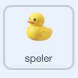
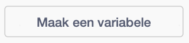
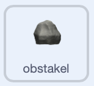

## Blokkeer de eend

Op dit moment zwemt je eend dwars door de rotsen heen. In deze stap zorg je ervoor dat de rotsen de weg blokkeren.

> [!TASK]
>
> {:width="100px"}
>
> In de **speler** sprite maak je 4 variabelen: `rechts geblokkeerd`{:class="block3variables"}, `links geblokkeerd`{:class="block3variables"}, `omhoog geblokkeerd`{:class="block3variables"}, en `omlaag geblokkeerd`{:class="block3variables"}. Vink hun selectievakjes uit zodat ze niet op het speelveld verschijnen.
>
> {:width="250"}

Je hebt dit `verander uiterlijk`{:class="block3looks"} script gemaakt voor de rechter pijl in stap 2:

```blocks3
if <key (right arrow v) pressed?> then
switch costume to (right v)
end
```

> [!TASK]
>
> Voeg onder het `verander uiterlijk`{:class="block3looks"}, een `als dan anders`{:class="block3control"} blok toe. Sleep een 'raak ik?'{:class="block3sensing"} blok erin en kies **obstakel**.
>
> ```blocks3
> if <key (right arrow v) pressed?> then
> switch costume to (right v)
> +if <touching (obstacle v)?> then
> else
> end
> end
> ```

> [!TASK]
>
> Als het een rots raakt, voeg dan een `maak rechts geblokkeerd`{:class="block3variables"} blok toe en stel dit in op `ja`.
>
> ```blocks3
> if <key (right arrow v) pressed?> then
> switch costume to (right v)
> if <touching (obstacle v)?> then
> +set [right blocked v] to [yes]
> else
> end
> end
> ```

> [!TASK]
>
> Voeg een `wacht 0.5 sec.`{:class="block3control"} blok er achteraan toe.
>
> ```blocks3
> if <key (right arrow v) pressed?> then
> switch costume to (right v)
> if <touching (obstacle v)?> then
> set [right blocked v] to [yes]
> +wait (0.5) seconds
> else
> end
> end
> ```

> [!TASK]
>
> Doe hetzelfde in het `anders`{:class="block3control"} gedeelte: voeg een `maak rechts geblokkeerd`{:class="block3variables"} blok toe en zet het op `nee`.
>
> ```blocks3
> if <key (right arrow v) pressed?> then
> switch costume to (right v)
> if <touching (obstacle v)?> then
> set [right blocked v] to [yes]
> wait (0.5) seconds
> else
> +set [right blocked v] to [no]
> end
> end
> ```

> [!TIP]
>
> Het `wacht 0.5 sec.`{:class="block3control"} blok zorgt er voor dat je van richting kan veranderen nadat je een rots hebt geraakt.

> [!TASK]
>
> Doe hetzelfde voor de andere drie pijltjestoetsen, gebruik daarvoor de `links geblokkeerd`{:class="block3variables"}, `omhoog geblokkeerd`{:class="block3variables"} en `omlaag geblokkeerd`{:class="block3variables"} variabelen.

Voeg nu de blok-variabelen toe aan de rots toe zodat deze stopt met bewegen wanneer hij geblokkeerd is.

> [!TASK]
>
> {:width="150"}
>
> Ga naar je **rots** sprite. In het `beweeg`{:class="block3myblocks"} blok voeg je een `en`{:class="block3operators"} blok toe en sleep je de `toets ingedrukt?`{:class="block3sensing"} naar het linkervakje.
>
> ```blocks3
> define move
> +if <<key (right arrow v) pressed?> and <>> then
> change x by ((0) - (rock speed))
> end
> ```

> [!TASK]
>
> Sleep een `is gelijk aan`{:class="block3operators"} blok (dit is het blokje met het = symbool) naar het `en`{:class="block3operators"} blok.
>
> ```blocks3
> define move
> if <<key (right arrow v) pressed?> and <() = ()>> then
> change x by ((0) - (rock speed))
> end
> ```

> [!TASK]
>
> Plaats `rechts geblokkeerd`{:class="block3variables"} blok in het linkervakje en `nee` in het rechtervakje, zodat de rots alleen beweegt wanneer de rechter pijl wordt ingedrukt en rechts niet wordt geblokkeerd.
>
> ```blocks3
> define move
> if <<key (right arrow v) pressed?> and <(right blocked) = [no]>> then
> change x by ((0) - (rock speed))
> end
> ```

> [!TASK]
>
> Dupliceer dit en doe hetzelfde voor elk van je pijltjestoetsen.
>
> ```blocks3
> define move
> if <<key (right arrow v) pressed?> and <(right blocked) = [no]>> then
> change x by ((0) - (rock speed))
> end
> +if <<key (left arrow v) pressed?> and <(left blocked) = [no]>> then
> change x by (rock speed)
> end
> +if <<key (down arrow v) pressed?> and <(down blocked) = [no]>> then
> change y by (rock speed)
> end
> +if <<key (up arrow v) pressed?> and <(up blocked) = [no]>> then
> change y by ((0) - (rock speed))
> end
> ```

**Test:** Zwem tegen een rots aan. Je eend moet stoppen in plaats van erover te zwemmen.

> [!DEBUG]
>
> De `wacht 0.5 seconden`{:class="block3control"} geeft je wat tijd om van richting te veranderen na een botsing, maar als je eend vast zit op een rots en er niet van af kan gaan, dan is dat omdat de 2 uiterlijken overlappen.
>
> Probeer het middelpunt van het uiterlijk van je eend te verplaatsen in de tekeneditor, of maak de sprite een beetje kleiner en test het totdat de eend altijd na een botsing kan wegzwemmen.
